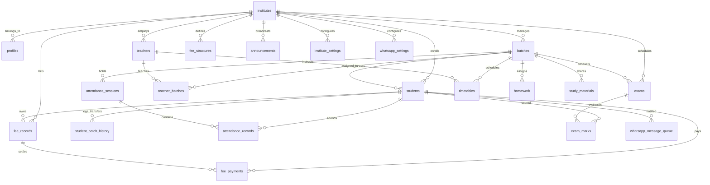

# Pradeep Classes Management Platform — Database Schema Documentation

**Database Server:** PostgreSQL 15 (Supabase ap-southeast-2)  
**Project ID:** `gajibrwnccddnrbnhwmh`  
**Primary Institute ID:** `11111111-2222-3333-4444-555555555555`  
**Total Tables:** 21 core tables + 1 storage bucket (`materials`)  
**Row-Level Security (RLS):** Enabled and enforced on 100% of tables (21/21)  

---

## 1. Entity-Relationship Overview

---

## 2. Table-by-Table Schema Reference

### 2.1. `institutes`
Master institute registry.
- `id` (uuid, PK, default `gen_random_uuid()`): Unique institute identifier.
- `name` (text, NOT NULL): Official institute name (e.g., `'Pradeep Classes'`).
- `code` (text, UNIQUE, NOT NULL): Unique slug (e.g., `'PRADEEP-KOTA'`).
- `address` (text): Primary campus address.
- `contact_email` (text): Administrative contact email.
- `contact_phone` (text): Primary telephone number.
- `is_active` (boolean, default `true`): Operational state.
- `created_at` (timestamptz, default `now()`).

### 2.2. `profiles`
User identity metadata and RBAC assignments mapping 1:1 with `auth.users`.
- `id` (uuid, PK, FK -> `auth.users.id` ON DELETE CASCADE).
- `institute_id` (uuid, NOT NULL, FK -> `institutes.id`).
- `email` (text, NOT NULL): User email address.
- `full_name` (text, NOT NULL): Display name.
- `role` (text, NOT NULL, CHECK `role IN ('owner', 'admin', 'teacher', 'student')`).
- `created_at` (timestamptz, default `now()`).
- `updated_at` (timestamptz, default `now()`).
- **Triggers:**
  - `trg_prevent_role_escalation`: Forbids self-promotion to owner/admin.
  - `trg_protect_profile_institute_id`: Forbids altering `institute_id`.

### 2.3. `batches`
Academic classroom sections and batches.
- `id` (uuid, PK, default `gen_random_uuid()`).
- `institute_id` (uuid, NOT NULL, FK -> `institutes.id`).
- `name` (text, NOT NULL): Batch name (e.g., `'JEE Advanced 2026'`).
- `course_name` (text, NOT NULL): Program curriculum.
- `academic_year` (text, NOT NULL): e.g., `'2026-2027'`.
- `max_capacity` (int, default `30`, CHECK `> 0`): Seat limit.
- `current_capacity` (int, default `0`, CHECK `>= 0`): Enrolled active students.
- `status` (text, default `'active'`, CHECK `IN ('active', 'completed', 'archived')`).
- `created_at` (timestamptz, default `now()`).
- **Triggers:**
  - `trg_validate_batch_capacity_update`: Prevents lowering `max_capacity` below `current_capacity`.
  - `trg_sync_batch_status`: Synchronizes active flag.

### 2.4. `students`
Student master roster and contact records.
- `id` (uuid, PK, default `gen_random_uuid()`).
- `profile_id` (uuid, NULLABLE, FK -> `profiles.id`): Associated user login.
- `institute_id` (uuid, NOT NULL, FK -> `institutes.id`).
- `batch_id` (uuid, NOT NULL, FK -> `batches.id`).
- `admission_no` (text, UNIQUE, NOT NULL): Format `PC-YYYY-XXXX` generated via sequence.
- `full_name` (text, NOT NULL): Student name.
- `phone` (text): Student mobile number.
- `parent_name` (text): Guardian / parent name (internal record).
- `parent_phone` (text): Guardian phone for emergency / notifications.
- `parent_relation` (text): Relationship (e.g., `'Father'`, `'Mother'`).
- `status` (text, default `'Active'`, CHECK `IN ('Active', 'Inactive', 'Suspended')`).
- `created_at` (timestamptz, default `now()`).
- **Triggers:**
  - `trg_generate_admission_no`: Automatically generates sequential `PC-YYYY-XXXX`.
  - `trg_enforce_student_batch_allocation`: Validates batch capacity and status before enrollment or transfer.

### 2.5. `student_batch_history`
Immutable audit log tracking all student admissions and batch transfers.
- `id` (uuid, PK, default `gen_random_uuid()`).
- `institute_id` (uuid, NOT NULL, FK -> `institutes.id`).
- `student_id` (uuid, NOT NULL, FK -> `students.id` ON DELETE CASCADE).
- `from_batch_id` (uuid, NULLABLE, FK -> `batches.id` ON DELETE SET NULL).
- `to_batch_id` (uuid, NOT NULL, FK -> `batches.id` ON DELETE SET NULL).
- `changed_by` (uuid, FK -> `auth.users.id`).
- `reason` (text): Transfer justification.
- `created_at` (timestamptz, default `now()`).
- **Triggers:**
  - `trg_prevent_history_deletion`: Direct `DELETE` blocked.
  - `trg_prevent_history_modification`: Direct `UPDATE` blocked.
  - `trg_validate_student_batch_history_tenant`: Cross-institute tenant check.

### 2.6. `teachers` & `teacher_batches`
Faculty members and batch assignments.
- `teachers`:
  - `id` (uuid, PK), `institute_id` (uuid), `profile_id` (uuid, NULLABLE), `full_name` (text), `subject` (text), `phone` (text), `is_active` (boolean), `created_at` (timestamptz).
- `teacher_batches`:
  - `id` (uuid, PK), `teacher_id` (uuid, FK -> `teachers.id`), `batch_id` (uuid, FK -> `batches.id`), `created_at` (timestamptz).
  - **Triggers:** `trg_validate_teacher_batches_tenant` ensures teacher and batch share same `institute_id`.

### 2.7. `attendance_sessions` & `attendance_records`
Daily roll call tracking with 48-hour modification limits.
- `attendance_sessions`:
  - `id` (uuid, PK), `institute_id` (uuid), `batch_id` (uuid, FK -> `batches.id`), `session_date` (date), `taken_by` (uuid, FK -> `auth.users.id`), `topic` (text), `created_at` (timestamptz).
  - Unique on `(batch_id, session_date)`.
- `attendance_records`:
  - `id` (uuid, PK), `institute_id` (uuid), `session_id` (uuid, FK -> `attendance_sessions.id`), `student_id` (uuid, FK -> `students.id`), `status` (text, CHECK `IN ('present', 'absent', 'late', 'leave')`), `note` (text), `marked_at` (timestamptz), `updated_at` (timestamptz).
  - Unique on `(session_id, student_id)`.
  - **Trigger:** `trg_validate_attendance_record` enforces cross-tenant integrity.

### 2.8. `whatsapp_settings` & `whatsapp_message_queue`
Asynchronous WhatsApp notification engine.
- `whatsapp_settings`:
  - `id` (uuid, PK), `institute_id` (uuid, UNIQUE), `is_enabled` (boolean), `phone_number_id` (text), `waba_id` (text), `access_token` (text), `test_mode` (boolean, default `true`), `verified_number` (text), `send_present_alert` (boolean), `send_absent_alert` (boolean), `send_late_alert` (boolean), `send_leave_alert` (boolean), `send_fee_receipt_alert` (boolean), `send_exam_result_alert` (boolean), `created_at` (timestamptz), `updated_at` (timestamptz).
- `whatsapp_message_queue`:
  - `id` (uuid, PK), `institute_id` (uuid), `student_id` (uuid, FK -> `students.id`), `phone_number` (text), `message_type` (text), `message_body` (text), `status` (text, CHECK `IN ('pending', 'sent', 'failed', 'skipped_test_mode')`), `attempts` (int, default `0`), `max_attempts` (int, default `3`), `error_message` (text), `session_date` (date), `sent_at` (timestamptz), `created_at` (timestamptz).
  - Unique on `(institute_id, student_id, phone_number, message_type, session_date)`.

### 2.9. `fee_structures`, `fee_records` & `fee_payments`
Tuition fee catalog, invoices, and immutable payment ledger.
- `fee_structures`:
  - `id` (uuid, PK), `institute_id` (uuid), `course_name` (text), `academic_year` (text), `total_fee` (numeric(10,2)), `description` (text), `created_at` (timestamptz).
- `fee_records`:
  - `id` (uuid, PK), `institute_id` (uuid), `student_id` (uuid, FK -> `students.id`), `fee_structure_id` (uuid, NULLABLE), `title` (text), `amount` (numeric(10,2), CHECK `> 0`), `paid_amount` (numeric(10,2), default `0`, CHECK `>= 0`), `discount_amount` (numeric(10,2), default `0`), `balance_due` (numeric(10,2) GENERATED ALWAYS AS `(amount - paid_amount - discount_amount)` STORED), `due_date` (date), `paid_date` (date), `status` (text, CHECK `IN ('pending', 'partial', 'paid', 'overdue')`), `receipt_no` (text), `payment_mode` (text), `transaction_ref` (text), `notes` (text), `created_at` (timestamptz), `updated_at` (timestamptz).
- `fee_payments` (Immutable Ledger):
  - `id` (uuid, PK), `institute_id` (uuid), `fee_record_id` (uuid, FK -> `fee_records.id`), `student_id` (uuid, FK -> `students.id`), `amount` (numeric(10,2), CHECK `> 0`), `payment_mode` (text, CHECK `IN ('cash', 'upi', 'netbanking', 'cheque', 'card')`), `transaction_ref` (text), `receipt_no` (text, NOT NULL), `payment_date` (date, default `CURRENT_DATE`), `notes` (text), `collected_by` (uuid, FK -> `auth.users.id`), `is_reversal` (boolean, default `false`), `reversal_ref_id` (uuid, FK -> `fee_payments.id`), `reversal_reason` (text), `created_at` (timestamptz, default `now()`).
  - **Trigger:** `trg_prevent_payment_ledger_tampering` intercepts all `UPDATE` and `DELETE` commands.

### 2.10. `exams` & `exam_marks`
Academic examinations, automated grading, and merit ranking.
- `exams`:
  - `id` (uuid, PK), `institute_id` (uuid), `batch_id` (uuid, FK -> `batches.id`), `title` (text), `subject` (text), `exam_type` (text, default `'unit_test'`), `exam_date` (date), `start_time` (time), `duration_minutes` (int, default `60`), `total_marks` (numeric(6,2), CHECK `> 0`), `passing_marks` (numeric(6,2), CHECK `> 0`), `status` (text, CHECK `IN ('draft', 'scheduled', 'completed', 'published')`), `created_by` (uuid, FK -> `auth.users.id`), `created_at` (timestamptz).
- `exam_marks`:
  - `id` (uuid, PK), `institute_id` (uuid), `exam_id` (uuid, FK -> `exams.id`), `student_id` (uuid, FK -> `students.id`), `marks_obtained` (numeric(6,2), CHECK `>= 0`), `is_absent` (boolean, default `false`), `percentage` (numeric(5,2)), `grade` (text, CHECK `IN ('A+', 'A', 'B', 'C', 'D', 'F')`), `rank_in_batch` (int), `is_passed` (boolean), `remarks` (text), `entered_by` (uuid, FK -> `auth.users.id`), `updated_at` (timestamptz).
  - Unique on `(exam_id, student_id)`.

### 2.11. `timetables`
Class schedules with conflict detection.
- `id` (uuid, PK), `institute_id` (uuid), `batch_id` (uuid, FK -> `batches.id`), `teacher_id` (uuid, NULLABLE, FK -> `teachers.id`), `subject` (text), `day_of_week` (text, CHECK `IN ('Monday', 'Tuesday', 'Wednesday', 'Thursday', 'Friday', 'Saturday', 'Sunday')`), `start_time` (time), `end_time` (time, CHECK `end_time > start_time`), `room_number` (text), `is_active` (boolean, default `true`), `created_at` (timestamptz).
- **Trigger:** `trg_check_timetable_conflicts` blocks double-booking of teachers and rooms across active slots.

### 2.12. `homework` & `study_materials`
Academic content distribution.
- `homework`:
  - `id` (uuid, PK), `institute_id` (uuid), `batch_id` (uuid, FK -> `batches.id`), `title` (text), `description` (text), `due_date` (date), `max_marks` (numeric(5,2)), `created_by` (uuid, FK -> `auth.users.id`), `created_at` (timestamptz).
- `study_materials`:
  - `id` (uuid, PK), `institute_id` (uuid), `batch_id` (uuid, NULLABLE, FK -> `batches.id`), `title` (text), `subject` (text), `description` (text), `category` (text, CHECK `IN ('notes', 'formula_sheet', 'pyq', 'assignment', 'other')`), `file_url` (text), `file_name` (text), `file_size_bytes` (bigint), `uploaded_by` (uuid, FK -> `auth.users.id`), `created_at` (timestamptz).

### 2.13. `announcements` & `institute_settings`
Institute profile and broadcasts.
- `announcements`:
  - `id` (uuid, PK), `institute_id` (uuid), `title` (text), `message` (text), `target_role` (text, CHECK `IN ('all', 'students', 'teachers', 'batch')`), `priority` (text, CHECK `IN ('normal', 'high', 'urgent')`), `batch_id` (uuid, NULLABLE, FK -> `batches.id`), `created_by` (uuid, FK -> `auth.users.id`), `created_at` (timestamptz).
- `institute_settings`:
  - `id` (uuid, PK), `institute_id` (uuid, UNIQUE), `institute_name` (text), `tagline` (text), `phone` (text), `email` (text), `address` (text), `city` (text), `state` (text), `pincode` (text), `website` (text), `logo_url` (text), `academic_year` (text), `default_pass_percentage` (numeric(5,2), default `40.0`), `fee_late_fine_daily` (numeric(10,2), default `50.0`), `currency_symbol` (text, default `'₹'`), `timezone` (text, default `'Asia/Kolkata'`), `meta` (jsonb), `created_at` (timestamptz), `updated_at` (timestamptz).

---

## 3. Stored Functions and RPC Definitions

| Function Name | Security | Purpose |
|---|---|---|
| `submit_batch_attendance(p_batch_id, p_session_date, p_topic, p_records)` | `SECURITY DEFINER` | Atomic attendance roll call submission & WhatsApp enqueuing |
| `collect_fee_payment(p_record_id, p_amount, p_payment_mode, p_transaction_ref, p_notes)` | `SECURITY DEFINER` | Atomic fee payment collection with `SELECT FOR UPDATE` locking |
| `reverse_fee_payment(p_payment_id, p_reason)` | `SECURITY DEFINER` | Reverses an existing payment, adjusts invoice balance, logs audit |
| `submit_exam_marks(p_exam_id, p_marks)` | `SECURITY DEFINER` | Records marks, computes percentages, grades (A+ to F), and dense ranks |
| `publish_exam_results(p_exam_id)` | `SECURITY DEFINER` | Publishes exam scores to student portals & enqueues results alert |
| `transfer_student_batch(p_student_id, p_to_batch_id, p_reason)` | `SECURITY DEFINER` | Transactional student batch reassignment with capacity enforcement |
| `create_student_fee_invoice(p_student_id, p_title, p_amount, p_due_date, ...)` | `SECURITY DEFINER` | Generates sequential invoice `INV-YYYY-XXXX` |
| `get_institute_fee_summary()` | `SECURITY DEFINER` | Aggregates institute billed, collected, and pending amounts |
| `get_institute_attendance_defaulters(p_threshold)` | `SECURITY DEFINER` | Identifies students whose attendance percentage is below threshold |
