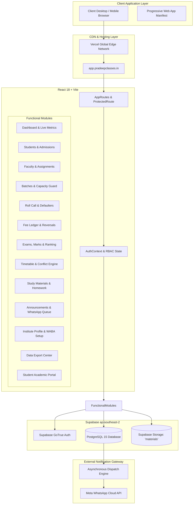

# Pradeep Classes Management Platform — Final System Architecture

**Document Version:** 2.0.0 (Production Release)  
**Target Institute:** Pradeep Classes, Kota Coaching Campus  
**Domain Deployment Target:** `app.pradeepclasses.in`  
**Public Website (Untouched):** `pradeepclasses.in`  
**Primary Database:** Supabase Enterprise PostgreSQL 15 (`gajibrwnccddnrbnhwmh`, Sydney `ap-southeast-2`)  
**Frontend Stack:** React 18, TypeScript 5.5, Vite 6, Tailwind CSS, Lucide Icons  

---

## 1. Executive Summary & Architectural Overview

The **Pradeep Classes Management Platform** is a specialized, production-ready coaching institute operating system engineered for high-volume academic operations. Designed exclusively for Pradeep Classes, the platform integrates administrative admissions, faculty scheduling, automated WhatsApp attendance notifications, multi-installment fee accounting with immutable audit ledgers, examination grading with dense ranking, homework distribution, and a dedicated student academic portal.

### Architectural Tenets
1. **Single-Tenant Operation with Multitenancy Isolation Safeguards:** Built solely for Pradeep Classes (`11111111-2222-3333-4444-555555555555`). Multi-tenant onboarding, tenant billing, and super-admin abstractions are explicitly excluded to keep workflows streamlined, while all 21 database tables strictly enforce `institute_id` Row-Level Security (RLS) to prevent cross-data leakage.
2. **Defensive Database-Centric Business Logic:** Concurrency-sensitive operations (admission numbering, capacity checking, payment collection, reversals, and schedule conflicts) are enforced through PostgreSQL row locks (`SELECT FOR UPDATE`), triggers, and `SECURITY DEFINER` stored procedures.
3. **Four Strictly Typed Roles (Parent Portal Deprecated):** The operational hierarchy comprises exactly 4 roles: `owner`, `admin`, `teacher`, and `student`. The Parent Portal was deliberately dismantled; guardian contact records are preserved on students exclusively for institute communication.
4. **Asynchronous WhatsApp Notification Dispatch:** Every attendance roll call automatically enqueues student notifications into `whatsapp_message_queue` with deduplication and safe test-mode execution.
5. **Zero Mock Data in Production Mode:** All views, KPI counters, transaction feeds, and reports query live Supabase PostgreSQL tables.

---

## 2. System Component Architecture

---

## 3. Core Subsystems

### 3.1. Authentication & Role-Based Access Control (RBAC)
- **Supabase GoTrue Engine:** Email/password authentication paired with JWT bearer tokens.
- **Profiles Table:** `public.profiles` maps 1:1 with `auth.users`, storing `role` (`owner`, `admin`, `teacher`, `student`) and `institute_id`.
- **Anti-Escalation Triggers:**
  - `trg_prevent_role_escalation`: Prevents non-owner users from updating their own or other users' roles to `owner` or `admin`.
  - `trg_protect_profile_institute_id`: Forbids altering `institute_id` once assigned.
  - `handle_new_user()` trigger rejects client-supplied `raw_user_meta_data.institute_id` to block unauthorized signup claiming.

### 3.2. Student Lifecycle & Batch Allocation
- **Admissions Engine:** Automated numbering formatted as `PC-YYYY-XXXX` generated via PostgreSQL sequence `admission_no_seq`.
- **Capacity Enforcement:** Batch capacity is guarded at the database level by `trg_enforce_student_batch_allocation`. Admissions or transfers that exceed `max_capacity` are rejected with error `P0003: Batch capacity exceeded`.
- **Audit History:** Every batch allocation and reassignment is recorded in `public.student_batch_history`. The table is protected by triggers `trg_prevent_history_deletion` and `trg_prevent_history_modification` making historical rows strictly immutable.

### 3.3. Attendance Management & Automated WhatsApp Dispatch
- **Session Submission RPC:** `public.submit_batch_attendance(p_batch_id, p_session_date, p_topic, p_records)` performs an atomic upsert of daily sessions and student marks.
- **Modification Guard:** Updates to attendance sessions older than 48 hours are rejected by `attendance_records_teacher_update` policy.
- **WhatsApp Integration Engine:** Immediately following roll call persistence, `queue_attendance_whatsapp_notification` enqueues formatted alerts:
  - **Present:** *"Hello [Student Name], your attendance at Pradeep Classes has been marked PRESENT for [Date]. Batch: [Batch Name]."*
  - **Absent:** *"Hello [Student Name], your attendance at Pradeep Classes has been marked ABSENT for [Date]. Batch: [Batch Name]. Please contact the institute if this is incorrect."*
  - **Late:** *"Hello [Student Name], your attendance at Pradeep Classes has been marked LATE for [Date]."*
  - **Leave:** *"Hello [Student Name], your attendance at Pradeep Classes has been marked as LEAVE for [Date]."*
- **Deduplication:** A unique constraint on `(institute_id, student_id, phone_number, message_type, session_date)` prevents duplicate messages if roll call is re-submitted.
- **Test Mode:** If `whatsapp_settings.test_mode = true`, messages are queued with status `skipped_test_mode`, allowing zero-failure local development without live Meta credentials.

### 3.4. Financial Ledger, Invoicing & Reversals
- **Sequential Invoices & Receipts:** Invoices follow `INV-YYYY-XXXX`; payment receipts follow `REC-YYYY-XXXX`.
- **Concurrency Row Locking:** `public.collect_fee_payment` acquires a database row lock via `SELECT FOR UPDATE` on `fee_records` before validating balances and writing payment entries.
- **Ledger Immutability:** Direct `UPDATE` and `DELETE` queries on `public.fee_payments` are blocked by trigger `trg_prevent_payment_ledger_tampering`.
- **Reversal Architecture:** Accidental or disputed payments are reversed via RPC `public.reverse_fee_payment(p_payment_id, p_reason)`. Reversals append a positive entry with `is_reversal = true`, generate a `REV-YYYY-XXXX` reference, log the audit reason, and automatically reopen the balance due on `fee_records`.

### 3.5. Examinations, Auto-Grading & Merit Ranking
- **Exam Management:** Supports unit tests, terminal exams, and competitive mocks with customizable total and passing marks.
- **Grading Scale:** Automatic score categorization:
  - $90\% \le \text{Score}$: **Grade A+**
  - $80\% \le \text{Score} < 90\%$: **Grade A**
  - $70\% \le \text{Score} < 80\%$: **Grade B**
  - $50\% \le \text{Score} < 70\%$: **Grade C**
  - $40\% \le \text{Score} < 50\%$: **Grade D**
  - $\text{Score} < 40\%$: **Grade F (Failed)**
- **Dense Ranking:** `submit_exam_marks` recalculates dense rank across all students in the batch.
- **Publish Workflow:** Results remain draft until published via `publish_exam_results()`, which makes scorecards visible on the Student Academic Portal and enqueues WhatsApp result alerts.

### 3.6. Timetable & Classroom Conflict Detection
- **Schedule Management:** Weekly schedule grid mapping batch, day of week, start time, end time, teacher, and classroom.
- **Conflict Engine:** Trigger `trg_check_timetable_conflicts` validates:
  1. That the assigned teacher is not already booked in another classroom during the overlapping time slot.
  2. That the room number is not already booked for another batch during the overlapping time slot.
  3. That `start_time < end_time`.

### 3.7. Academic Content Repository & Storage
- **Study Materials:** Categorized by notes, formula sheets, previous year questions (PYQs), and practice sets.
- **Storage Bucket:** Backed by Supabase Storage bucket `materials` with public read access and authenticated staff upload RLS.
- **Homework Assignments:** Assignments assigned per batch with submission deadlines, score maximums, and detailed task descriptions.

### 3.8. Student Academic Portal
- Pure student-focused interface replacing the deprecated Parent Portal.
- Tabs for Attendance (% rate, compliance badge, session history), Exams & Report Cards, Fee Ledger & Printable Receipts, Study Materials Downloads, and Weekly Timetable.

---

## 4. Network and Deployment Topography

| Environment | Hostname | Provider | Function |
|---|---|---|---|
| **Public Site** | `pradeepclasses.in` | External (Untouched) | Marketing Landing Page |
| **Application** | `app.pradeepclasses.in` | Vercel Edge Network | Management Portal & PWA |
| **Database** | `gajibrwnccddnrbnhwmh.supabase.co` | Supabase (AWS ap-southeast-2) | PostgreSQL 15, Auth, Storage |
| **Messaging** | `graph.facebook.com/v18.0` | Meta WhatsApp Cloud API | Automated Student Notifications |
