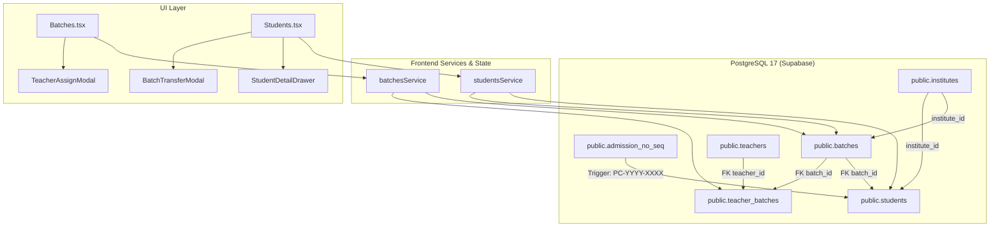

# Milestone 2: Student & Batch Management Implementation Plan

> **For agentic workers:** REQUIRED SUB-SKILL: Use superpowers:subagent-driven-development (recommended) or superpowers:executing-plans to implement this plan task-by-task. Steps use checkbox (`- [ ]`) syntax for tracking.

**Goal:** Build and deploy production-ready Student and Batch Management for Pradeep Classes with live Supabase database synchronization, automated sequential admission numbers, capacity tracking, student-to-batch transfers, teacher-batch allocation, and multi-tenant schema foundations for future EduManage SaaS expansion.

**Architecture:** A layered architecture with Supabase PostgreSQL 17 hosting strict schemas, sequences, and triggers; typed service modules (`studentsService`, `batchesService`) communicating with Supabase; and modular React components providing responsive forms, drawers, filters, progress bars, and modals.

**Architecture Diagram:**



**Tech Stack:** React 18, TypeScript 5, Vite 6, Tailwind CSS, Lucide React, Supabase JS Client (`@supabase/supabase-js`), PostgreSQL 17.

**Spec:** [milestone-2-audit-and-spec.md](file:///C:/Users/hp/.gemini/antigravity/brain/b9088e07-38ea-4a26-81d8-f46a2a561a75/milestone-2-audit-and-spec.md)

## Global Constraints
- Target Supabase project: `pradeep-classes-management` (`gajibrwnccddnrbnhwmh`).
- Do not modify, reapply, or drop migrations `0001`, `0002`, `0003`, or `0004`. All database changes must be in new sequential migration `0005_student_batch_management.sql`.
- Do not modify or break the public website `pradeepclasses.in`.
- Default `institute_id` must be fixed UUID `'11111111-2222-3333-4444-555555555555'` (Pradeep Classes).
- Never expose service-role key or credentials in client code.
- Must pass `npx.cmd tsc --noEmit` and `npm.cmd run build` with 0 errors.

## Review Focus
- Admission number sequence collision under simultaneous student creation: trigger must handle null/empty `admission_no` seamlessly.
- Batch capacity exceeding maximum seats: UI must warn when enrolling beyond `max_capacity`.
- Batch transfer updating student counts accurately: moving a student between batches must maintain accurate counts without manual recalculations.
- Teacher batch allocation junction table integrity: adding or removing a teacher from a batch must update `teacher_batches` without cascading deletions to teachers or batches.
- Multi-criteria filter combinations returning empty state cleanly: combining search query with non-matching batch/class/status must show polished empty state with reset filter action.

---

### Task 1: Database Migration `0005_student_batch_management.sql`

**Files:**
- Create: `supabase/migrations/0005_student_batch_management.sql`
- Verify: Remote PostgreSQL 17 on `gajibrwnccddnrbnhwmh`

**Interfaces:**
- Consumes: Tables `students`, `batches`, `teachers`, `teacher_batches` from migrations 0001–0004.
- Produces: Table `institutes`, sequence `admission_no_seq`, function `fn_generate_admission_no()`, triggers `trg_generate_admission_no`, `trg_sync_student_batch_name`, and columns on `students` and `batches`.

- [ ] **Step 1: Write Migration SQL file `supabase/migrations/0005_student_batch_management.sql`**
  - Create `public.institutes` table (`id uuid primary key default gen_random_uuid()`, `name text not null`, `slug text not null unique`, `logo_url text`, `is_active boolean not null default true`, `created_at timestamptz not null default now()`).
  - Seed Pradeep Classes row with `id = '11111111-2222-3333-4444-555555555555'`, `name = 'Pradeep Classes'`, `slug = 'pradeep-classes'`.
  - Add `institute_id` column with default `'11111111-2222-3333-4444-555555555555'` to `students`, `batches`, `teachers`, `teacher_batches`, `profiles`, `attendance_sessions`, `fee_structures`, `fee_records`, `audit_logs`.
  - Add columns to `batches`: `max_capacity integer not null default 40 check (max_capacity > 0)`, `timing text`, `room_number text`, `start_date date`, `end_date date`, `status text not null default 'active' check (status in ('active', 'completed', 'archived'))`, `updated_at timestamptz not null default now()`.
  - Add columns to `students`: `email text`, `date_of_birth date`, `gender text check (gender in ('male', 'female', 'other'))`, `address text`, `city text default 'Kota'`, `emergency_contact text`, `parent_relation text default 'Parent'`, `parent_email text`, `notes text`, `photo_url text`.
  - Create sequence `public.admission_no_seq minvalue 1 start with 1001`.
  - Create trigger function `public.fn_generate_admission_no()`:
    ```sql
    create or replace function public.fn_generate_admission_no()
    returns trigger as $$
    begin
      if new.admission_no is null or trim(new.admission_no) = '' then
        new.admission_no := 'PC-' || to_char(current_date, 'YYYY') || '-' || lpad(nextval('public.admission_no_seq')::text, 4, '0');
      end if;
      return new;
    end;
    $$ language plpgsql;
    ```
  - Create trigger `trg_generate_admission_no` on `public.students` `before insert for each row execute function public.fn_generate_admission_no()`.
  - Create trigger function `public.fn_sync_student_batch_name()` to keep `students.batch_name` synced with `batches.name` based on `NEW.batch_id`.
  - Grant appropriate permissions and add RLS policies for `public.institutes`.

- [ ] **Step 2: Apply Migration to Remote Supabase**
  Run: `$env:SUPABASE_ACCESS_TOKEN = "<SUPABASE_ACCESS_TOKEN>"; npx.cmd supabase db query --remote=gajibrwnccddnrbnhwmh --file="supabase/migrations/0005_student_batch_management.sql"`
  Expected: Success with 0 errors.

- [ ] **Step 3: Verify Remote Schema with Read-Only Query**
  Run: `npx.cmd supabase db query --remote=gajibrwnccddnrbnhwmh --read-only "SELECT column_name, data_type FROM information_schema.columns WHERE table_name = 'batches' AND column_name IN ('max_capacity', 'timing', 'room_number', 'status', 'institute_id');"`
  Expected: 5 rows returned.

- [ ] **Step 4: Commit**
  ```bash
  git add supabase/migrations/0005_student_batch_management.sql
  git commit -m "feat(db): add milestone 2 student and batch schema migration 0005"
  ```

---

### Task 2: Service Layer & TypeScript Interfaces Expansion

**Files:**
- Modify: `src/types/institute.ts`
- Modify: `src/services/batchesService.ts`
- Modify: `src/services/studentsService.ts`

**Interfaces:**
- Consumes: Supabase client in `src/lib/supabase.ts` and enhanced schema columns.
- Produces:
  - `Student` interface with optional `email`, `date_of_birth`, `gender`, `address`, `city`, `emergency_contact`, `parent_relation`, `parent_email`, `notes`.
  - `Batch` interface with `max_capacity`, `timing`, `room_number`, `status`, `start_date`, `end_date`.
  - `studentsService.getStudents(params?: StudentFilterParams): Promise<{ data: Student[]; count: number; error?: string }>`
  - `studentsService.getLiveBatches(): Promise<{ id: string; name: string; course_name: string }[]>`
  - `studentsService.updateStudent(id: string, updates: Partial<Student>): Promise<{ data: Student | null; error?: string }>`
  - `studentsService.transferBatch(studentId: string, newBatchId: string, newBatchName: string): Promise<{ success: boolean; error?: string }>`
  - `batchesService.updateBatch(id: string, updates: Partial<Batch>): Promise<{ data: Batch | null; error?: string }>`
  - `batchesService.getBatchRoster(batchId: string): Promise<{ data: Student[]; error?: string }>`
  - `batchesService.assignTeacher(batchId: string, teacherId: string): Promise<{ success: boolean; error?: string }>`
  - `batchesService.removeTeacher(batchId: string, teacherId: string): Promise<{ success: boolean; error?: string }>`

- [ ] **Step 1: Update `src/types/institute.ts` with comprehensive data models**
  Expand `Student`, `Batch`, and add `StudentFilterParams`, `BatchTransferPayload`.

- [ ] **Step 2: Update `src/services/batchesService.ts`**
  Implement `updateBatch`, `getBatchRoster`, `assignTeacher`, `removeTeacher`, and calculate `capacity_percentage`.

- [ ] **Step 3: Update `src/services/studentsService.ts`**
  Implement `updateStudent`, `transferBatch`, `getLiveBatches`, and retire hardcoded `demo.ts` batches.

- [ ] **Step 4: Verify TypeScript compilation**
  Run: `npx.cmd tsc --noEmit`
  Expected: 0 errors.

- [ ] **Step 5: Commit**
  ```bash
  git add src/types/institute.ts src/services/batchesService.ts src/services/studentsService.ts
  git commit -m "feat(services): expand student and batch services for milestone 2"
  ```

---

### Task 3: Batch Management UI & Faculty Assignment

**Files:**
- Modify: `src/pages/Batches.tsx`
- Create: `src/components/batches/BatchModal.tsx` (Create & Edit Batch)
- Create: `src/components/batches/BatchRosterDrawer.tsx` (Inspect enrolled students)
- Create: `src/components/batches/TeacherAssignModal.tsx` (Assign faculty)

**Interfaces:**
- Consumes: `batchesService`, `teachersService`, `Batch` type.
- Produces: Comprehensive Batch management page with cards, progress bars, edit actions, faculty assignments, and roster inspection.

- [ ] **Step 1: Create `BatchModal.tsx` supporting both Create and Edit modes**
  Fields: Batch Name, Course Name (with preset or custom options), Academic Year, Max Capacity (number, default 40), Timing (text), Room Number (text), Status (Active, Completed, Archived).

- [ ] **Step 2: Create `TeacherAssignModal.tsx`**
  Allows selecting from registered teachers and linking them to the active batch via `batchesService.assignTeacher` and `removeTeacher`.

- [ ] **Step 3: Create `BatchRosterDrawer.tsx`**
  Slide-out panel listing all students enrolled in the clicked batch, showing admission number, student name, contact, and action to transfer or view student.

- [ ] **Step 4: Update `src/pages/Batches.tsx`**
  Integrate cards with capacity bars (`28/40 Seats (70%)`), status badges, Edit Batch button, Assign Teacher button, and View Roster button.

- [ ] **Step 5: Verify build & TypeScript**
  Run: `npx.cmd tsc --noEmit`
  Expected: 0 errors.

- [ ] **Step 6: Commit**
  ```bash
  git add src/pages/Batches.tsx src/components/batches/
  git commit -m "feat(batches): implement batch crud, capacity tracking, and teacher assignment"
  ```

---

### Task 4: Student Admission & Directory UI

**Files:**
- Modify: `src/pages/Students.tsx`
- Create: `src/components/students/AdmissionModal.tsx` (Multi-step admission form)
- Create: `src/utils/csvExport.ts` (Client-side CSV exporter)

**Interfaces:**
- Consumes: `studentsService.getLiveBatches()`, `studentsService.createStudent()`, `studentsService.updateStudent()`.
- Produces: Polished student directory with search, live batch filter, class filter, status filter, CSV export, and responsive table.

- [ ] **Step 1: Create `src/utils/csvExport.ts`**
  Generates and triggers download of CSV from an array of student objects with formatted column headers.

- [ ] **Step 2: Create `AdmissionModal.tsx`**
  Multi-tab or categorized form:
  - Personal Information: Full Name, Date of Birth, Gender, Mobile, Email, Address, City.
  - Academic & Batch: Class (Class 9, 10, 11, 12, Dropper), Live Batch Select (queries Supabase `batches`), Joining Date.
  - Parent / Guardian: Parent Name, Relationship, Mobile, Parent Email, Emergency Contact.
  - Server-side submit with validation and automated database sequence `admission_no`.

- [ ] **Step 3: Update `src/pages/Students.tsx`**
  - Connect search input, live batch select filter, class filter, and status filter.
  - Add client pagination (e.g. 15–20 per page with Next/Prev controls).
  - Connect "Export CSV" to `csvExport.ts`.
  - Add row action buttons: "View Profile", "Edit Student", "Transfer Batch".

- [ ] **Step 4: Verify build & TypeScript**
  Run: `npx.cmd tsc --noEmit`
  Expected: 0 errors.

- [ ] **Step 5: Commit**
  ```bash
  git add src/pages/Students.tsx src/components/students/AdmissionModal.tsx src/utils/csvExport.ts
  git commit -m "feat(students): implement multi-step admission, dynamic filters, and csv export"
  ```

---

### Task 5: Student Profile Detail Drawer & Batch Transfer Workflow

**Files:**
- Create: `src/components/students/StudentDetailDrawer.tsx`
- Create: `src/components/students/BatchTransferModal.tsx`
- Modify: `src/pages/Students.tsx`

**Interfaces:**
- Consumes: Selected student, `batchesService.getBatches()`, `studentsService.transferBatch()`.
- Produces: Slide-over detailed profile inspection and safe batch transfer with real-time UI updates.

- [ ] **Step 1: Create `BatchTransferModal.tsx`**
  Displays current batch, allows selecting a destination batch, validates destination capacity, and calls `studentsService.transferBatch(studentId, newBatchId, newBatchName)`.

- [ ] **Step 2: Create `StudentDetailDrawer.tsx`**
  Displays:
  - Header: Avatar initials, Full Name, Admission ID, Status Badge.
  - Contact Information: Mobile, Email, Address, Emergency Contact.
  - Academic Profile: Class, Current Batch, Room, Timing, Joining Date.
  - Parent / Guardian Details: Parent Name, Relation, Parent Mobile, Parent Email.
  - Quick action buttons: "Transfer Batch", "Edit Details".

- [ ] **Step 3: Connect Drawer and Transfer Modal in `Students.tsx`**
  Wire clicking a row or "View Profile" to open `StudentDetailDrawer`, and wire "Transfer Batch" to open `BatchTransferModal`.

- [ ] **Step 4: Verify build & TypeScript**
  Run: `npx.cmd tsc --noEmit`
  Expected: 0 errors.

- [ ] **Step 5: Commit**
  ```bash
  git add src/components/students/StudentDetailDrawer.tsx src/components/students/BatchTransferModal.tsx src/pages/Students.tsx
  git commit -m "feat(students): add student profile detail drawer and batch transfer modal"
  ```

---

### Task 6: Full Verification, Production Build & Milestone Acceptance

**Files:**
- Verify: Full repository and live database

- [ ] **Step 1: Run TypeScript strict check**
  Run: `npx.cmd tsc --noEmit`
  Expected: 0 errors.

- [ ] **Step 2: Run Production Build**
  Run: `npm.cmd run build`
  Expected: Clean build in `dist/` with zero warnings or errors.

- [ ] **Step 3: Test Live Workflows**
  - Verify creating a new batch in `Batches.tsx` creates the record in Supabase.
  - Verify the new batch appears in the `Students.tsx` admission modal dropdown immediately.
  - Verify admitting a student produces sequential admission number (e.g. `PC-2026-1001`).
  - Verify transferring the student to another batch updates both batches' student counts.
  - Verify CSV export downloads valid formatted CSV file.

- [ ] **Step 4: Final Git Push**
  Push all commits to GitHub repository.
