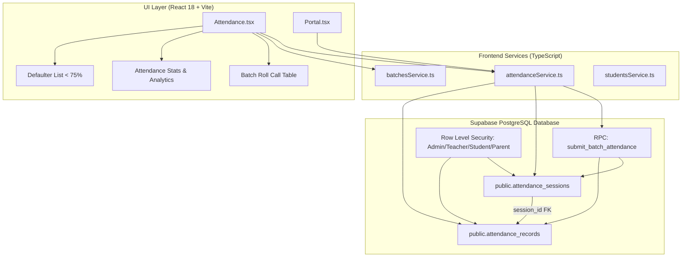

# Milestone 3: Attendance Management & Daily Academic Operations Implementation Plan

> **For agentic workers:** REQUIRED SUB-SKILL: Use superpowers:subagent-driven-development (recommended) or superpowers:executing-plans to implement this plan task-by-task. Steps use checkbox (`- [ ]`) syntax for tracking.

**Goal:** Deliver a production-grade, multi-tenant daily Attendance Management system for Pradeep Classes with batch-scoped roll call marking, atomic database upserts, teacher role scoping, student & parent portal synchronization, attendance analytics with low-attendance warnings (<75%), and CSV audit export.

**Architecture:**
- **Database Layer**: PostgreSQL 17 / Supabase with `attendance_sessions` and `attendance_records` tables; atomic RPC `submit_batch_attendance()` for atomic session creation and student record upserts; teacher update policy allowing teachers to revise sessions they recorded; multi-tenant `institute_id` RLS guarantees.
- **Service Layer**: `attendanceService.ts` providing typed methods for live session fetching, roll call submission, attendance aggregation, defaulter analysis, and CSV export.
- **UI Layer**: Reusable attendance components (`BatchRollCallTable`, `AttendanceStatSummary`, `AttendanceDefaultersDrawer`), connected to live database state in `src/pages/Attendance.tsx` and mirrored in the student/parent `src/pages/Portal.tsx`.

---

## Architecture Diagram

---

## File Structure

| Action | Path | Responsibility |
| :--- | :--- | :--- |
| **Create** | `supabase/migrations/0007_attendance_management.sql` | Atomic `submit_batch_attendance()` RPC, teacher update RLS policy, attendance calculation helper functions |
| **Create** | `src/types/attendance.ts` | TypeScript domain interfaces for sessions, roll call records, batch summaries, and analytics |
| **Create** | `src/services/attendanceService.ts` | Data service for Supabase attendance operations, batch roll call, analytics, and CSV exports |
| **Modify** | `src/types/index.ts` | Re-export attendance types |
| **Create** | `src/components/attendance/AttendanceStats.tsx` | Summary KPI cards (Present, Absent, Late, Leave, Attendance Rate %) |
| **Create** | `src/components/attendance/RollCallTable.tsx` | Interactive roll call table with one-click P/A/L/E buttons and bulk actions |
| **Create** | `src/components/attendance/AttendanceDefaultersModal.tsx` | Modal displaying students with attendance below 75% threshold |
| **Modify** | `src/pages/Attendance.tsx` | Connect to live database, batch selection, date picker, roll call saving, analytics, CSV export |
| **Modify** | `src/pages/Portal.tsx` | Display live attendance rates, attendance breakdown, and session logs for students and parents |
| **Create** | `tests/database/verify_milestone3_attendance.sql` | Automated SQL test suite for attendance RPC, teacher scoping, and student/parent visibility |

---

## Implementation Tasks

### Task 1: Migration 0007 — Atomic Attendance RPC & Teacher Update Policy
- [ ] Create `supabase/migrations/0007_attendance_management.sql`.
- [ ] Add `attendance_records_teacher_update` policy for teachers who took the session.
- [ ] Add transactional RPC `submit_batch_attendance(p_batch_id uuid, p_session_date date, p_records jsonb)`.
- [ ] Add analytics function `get_student_attendance_stats(p_student_id uuid)` and `get_batch_attendance_defaulters(p_batch_id uuid, p_threshold numeric)`.
- [ ] Verify migration locally and dry-run against remote Supabase database.
- [ ] Apply migration `0007` to remote Supabase.

### Task 2: Type Definitions & Service Layer
- [ ] Create `src/types/attendance.ts` defining `AttendanceSession`, `AttendanceRecord`, `AttendanceStatus`, `RollCallItem`, `AttendanceSummary`.
- [ ] Export from `src/types/index.ts`.
- [ ] Create `src/services/attendanceService.ts` with methods:
  - `getBatchAttendance(batchId: string, date: string)`
  - `saveBatchAttendance(batchId: string, date: string, records: RollCallItem[])`
  - `getBatchDefaulters(batchId: string, threshold?: number)`
  - `getStudentAttendanceSummary(studentId: string)`
  - `exportAttendanceCsv(batchName: string, date: string, records: RollCallItem[])`

### Task 3: Interactive Attendance Components
- [ ] Create `src/components/attendance/AttendanceStats.tsx` (Total, Present, Absent, Late, Rate %).
- [ ] Create `src/components/attendance/RollCallTable.tsx` (Student list, quick toggles, bulk "All Present", note input).
- [ ] Create `src/components/attendance/AttendanceDefaultersModal.tsx` (List of students < 75% with contact info).

### Task 4: Connect `Attendance.tsx` to Live Database
- [ ] Fetch live batches (scoped to assigned batches for teachers, all batches for admin/owner).
- [ ] Date picker with quick navigation (Today, Yesterday).
- [ ] Sync roll call state with live `attendance_records`.
- [ ] Implement honest empty states when no students are enrolled in the batch.
- [ ] Wire "Save Attendance Roll" to `attendanceService.saveBatchAttendance`.
- [ ] Add CSV export and Defaulters modal triggers.

### Task 5: Student & Parent Portal Integration
- [ ] Update `src/pages/Portal.tsx` to load live attendance percentage and history for the logged-in student or parent.
- [ ] Render visual attendance progress bar and recent session status badges.

### Task 6: Verification & Test Suite
- [ ] Run `verify_milestone3_attendance.sql` on remote database to prove database constraints, RPC idempotency, and RLS enforcement.
- [ ] Run `npx tsc --noEmit` and `npm run build` to ensure 0 TypeScript or build warnings.
- [ ] Verify frontend in browser / dev server.
- [ ] Commit and push changes to GitHub `origin/main`.
