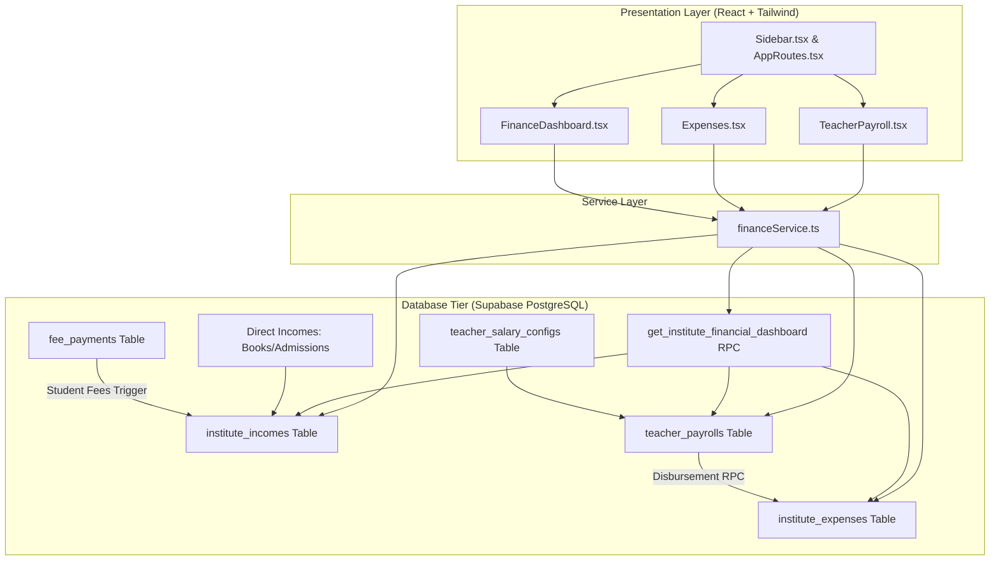

# Phase 1: Institute Finance & Teacher Payroll Implementation Plan

> **For agentic workers:** REQUIRED SUB-SKILL: Use superpowers:subagent-driven-development (recommended) or superpowers:executing-plans to implement this plan task-by-task. Steps use checkbox (`- [ ]`) syntax for tracking.

**Goal:** Build a complete, audit-grade institute finance and teacher payroll management system for Pradeep Classes that tracks all operational revenue, institute expenses, faculty compensation structures, monthly payroll settlements, and financial health analytics with atomic database operations and zero mock data.

**Architecture:** A double-entry capable financial ledger anchored by PostgreSQL tables (`institute_incomes`, `institute_expenses`, `teacher_salary_configs`, `teacher_payrolls`) in Supabase, secured with Owner-exclusive and Admin-restricted Row Level Security (RLS). Real-time financial calculations (net operating surplus, fee collections vs other revenue, categorical expense breakdowns, and faculty liabilities) are computed directly via a database-level aggregation RPC (`get_institute_financial_dashboard`) and an atomic payroll disbursement RPC (`record_teacher_payroll_payment`), consumed by a type-safe TypeScript service layer and responsive Tailwind CSS / Lucide dashboards.

**Architecture Diagram:**



**Tech Stack:** React 18, TypeScript 5, Vite, Tailwind CSS, Lucide React, Supabase PostgreSQL, Supabase Storage (`expense-receipts` bucket).

**Spec:** [`product-expansion-spec-and-roadmap.md`](file:///C:/Users/hp/.gemini/antigravity/brain/b9088e07-38ea-4a26-81d8-f46a2a561a75/product-expansion-spec-and-roadmap.md) (Section A: Institute Finance & Business Analytics)

---

## Global Constraints

- Retain single-institute architecture dedicated to Pradeep Classes (`institute_id = '11111111-2222-3333-4444-555555555555'`).
- Role-based permissions: Owner has full operational and configuration access; Admin has operational expense entry and view access; Teacher and Student roles are strictly barred from financial routes and tables.
- Append-only ledger discipline: Financial transactions cannot be destructively updated or deleted; cancellations and corrections must be handled via audited reversals (`status = 'reversed'`).
- Zero mock data: All cards, charts, ledgers, and summaries must read live records from Supabase with realistic database seed records.
- Production environment compatibility: Maintain strict compatibility with `https://app.pradeepclasses.in` and keep TypeScript compilation clean (`tsc -b && vite build` 0 errors).

---

## Review Focus

1. **Duplicate Expense Submissions:** Rapid double-clicking or network retries on the "Add Expense" form could create duplicate outflow records. (Test: Verify idempotency / disabling submit state during API calls).
2. **Negative Currency Amounts:** Entering negative numbers for income, expenses, allowances, or deductions could invert ledger balances. (Test: Check database `CHECK (amount > 0)` constraints and client validation).
3. **Double Payroll Disbursement:** Triggering payment on an already "paid" payroll month for a teacher must be rejected atomically. (Test: Check `status = 'pending'` guard in `record_teacher_payroll_payment`).
4. **Orphaned Receipt Attachments:** File uploads for expense receipts must securely land in the `expense-receipts` Supabase Storage bucket and generate a verifiable URL before the record commits. (Test: Verify storage upload error handling).
5. **Unauthorized Financial Leakage:** Teachers and students inspecting network requests or accessing `/finance` routes must be blocked at both RLS and routing layers. (Test: Verify RLS denial for non-admin/owner roles).

---

### Task 1: Database Migration — Financial Ledger & Payroll Schema

**Files:**
- Create: `supabase/migrations/0011_institute_finance_and_payroll.sql`
- Test: `tests/database/verify_finance_and_payroll.sql`

**Interfaces:**
- Consumes: `public.institutes(id)`, `public.teachers(id)`, `public.fee_payments(id)`, `public.profiles(id)`
- Produces: Tables `institute_incomes`, `institute_expenses`, `teacher_salary_configs`, `teacher_payrolls`, RPC `get_institute_financial_dashboard`, RPC `record_teacher_payroll_payment`.

- [ ] **Step 1: Write the failing SQL test script**

Create `tests/database/verify_finance_and_payroll.sql` asserting that the four tables exist, check constraints enforce positive amounts, RLS is enabled, and the two RPCs execute without errors.

```sql
-- tests/database/verify_finance_and_payroll.sql
DO $$
BEGIN
  ASSERT (SELECT count(*) FROM information_schema.tables WHERE table_schema = 'public' AND table_name IN ('institute_incomes', 'institute_expenses', 'teacher_salary_configs', 'teacher_payrolls')) = 4, 'All 4 finance tables must exist';
  ASSERT (SELECT count(*) FROM pg_proc WHERE proname IN ('get_institute_financial_dashboard', 'record_teacher_payroll_payment')) = 2, 'Both finance RPCs must exist';
  RAISE NOTICE 'Finance database verification passed';
END $$;
```

- [ ] **Step 2: Run test to verify it fails**

Execute the test via Supabase MCP `execute_sql`.
Expected: FAIL with message indicating tables or functions do not exist.

- [ ] **Step 3: Implement migration `supabase/migrations/0011_institute_finance_and_payroll.sql`**

Write the complete SQL migration containing:
1. `institute_incomes` table with columns: `id`, `institute_id`, `source_type` (`student_fee`, `admission_fee`, `study_material`, `other`), `amount` (`CHECK > 0`), `payment_method` (`cash`, `upi`, `bank_transfer`, `cheque`, `other`), `transaction_reference`, `income_date`, `description`, `fee_payment_id` (nullable foreign key), `status` (`completed`, `reversed`), `reversal_reason`, `recorded_by`, `created_at`, `updated_at`.
2. `institute_expenses` table with columns: `id`, `institute_id`, `category` (`rent`, `electricity_utilities`, `internet_software`, `stationery_supplies`, `marketing_advertising`, `maintenance`, `teacher_payroll`, `other`), `amount` (`CHECK > 0`), `expense_date`, `payment_method`, `description`, `receipt_url`, `vendor_name`, `status` (`approved`, `reversed`), `reversal_reason`, `recorded_by`, `created_at`, `updated_at`.
3. `teacher_salary_configs` table with columns: `id`, `institute_id`, `teacher_id` (unique), `calculation_type` (`monthly_fixed`, `per_lecture`, `hourly`), `base_amount` (`CHECK >= 0`), `per_lecture_rate` (`CHECK >= 0`), `created_at`, `updated_at`.
4. `teacher_payrolls` table with columns: `id`, `institute_id`, `teacher_id`, `payroll_month` (`varchar(7)` e.g. `'2026-11'`), `base_salary`, `lecture_count`, `lecture_amount`, `allowances`, `deductions`, `bonus`, `net_amount`, `status` (`pending`, `paid`, `cancelled`), `payment_date`, `payment_method`, `transaction_reference`, `notes`, `processed_by`, `expense_id` (foreign key to `institute_expenses`), `created_at`, `updated_at`. Unique constraint on `(teacher_id, payroll_month)`.
5. RLS policies:
   - `institute_incomes`: SELECT/INSERT/UPDATE for `owner` and `admin`. Deny all for `teacher` and `student`.
   - `institute_expenses`: SELECT/INSERT/UPDATE for `owner` and `admin`. Deny all for `teacher` and `student`.
   - `teacher_salary_configs`: Full access for `owner`; SELECT for `admin`. Deny all for `teacher` and `student`.
   - `teacher_payrolls`: Full access for `owner`; SELECT/INSERT for `admin`; SELECT own records for `teacher` (where `teacher.profile_id = auth.uid()`).
6. Supabase Storage bucket `expense-receipts` created with authenticated read/write policy.
7. RPC `get_institute_financial_dashboard(p_start_date date, p_end_date date)`: SECURITY DEFINER aggregation returning:
   - `total_fees_billed`: Sum from `fee_installments`.
   - `total_fees_collected`: Sum from `fee_payments` where `status = 'completed'`.
   - `outstanding_dues`: `total_fees_billed - total_fees_collected`.
   - `total_other_income`: Sum from `institute_incomes` where `source_type != 'student_fee'` and `status = 'completed'`.
   - `total_expenses`: Sum from `institute_expenses` where `status = 'approved'`.
   - `total_teacher_salaries_paid`: Sum from `teacher_payrolls` where `status = 'paid'`.
   - `net_operating_surplus`: `(total_fees_collected + total_other_income) - total_expenses`.
   - `expenses_by_category`: JSON array `[{ category, total_amount }]`.
   - `incomes_by_method`: JSON array `[{ payment_method, total_amount }]`.
   - `monthly_trends`: Monthly collection and expense totals for the past 6 months.
8. RPC `record_teacher_payroll_payment(p_payroll_id uuid, p_payment_method text, p_transaction_reference text, p_notes text)`:
   - Validates payroll exists and `status = 'pending'`.
   - Inserts row into `institute_expenses` under category `'teacher_payroll'`.
   - Updates `teacher_payrolls` status to `'paid'`, sets `payment_date = CURRENT_DATE`, links `expense_id`.
9. Seed initial data: Salary configurations for the 3 teachers (`Dr. Rajesh Sharma`, `Prof. Sunita Patil`, `Er. Manoj Deshmukh`), 1 pending payroll sheet for current month, and realistic expense records (Rent, Internet, Electricity) for Pradeep Classes.

- [ ] **Step 4: Run test to verify it passes**

Apply the migration via Supabase and execute `tests/database/verify_finance_and_payroll.sql`.
Expected: `Finance database verification passed`.

- [ ] **Step 5: Commit**

```bash
git add supabase/migrations/0011_institute_finance_and_payroll.sql tests/database/verify_finance_and_payroll.sql
git commit -m "feat(db): add institute finance and teacher payroll schema, RLS, and RPCs"
```

---

### Task 2: Service Layer — Finance & Payroll Service

**Files:**
- Create: `src/services/financeService.ts`
- Create: `src/types/finance.ts`

**Interfaces:**
- Consumes: `src/lib/supabase.ts`, `src/types/index.ts`
- Produces:
  - Types: `InstituteIncome`, `InstituteExpense`, `TeacherSalaryConfig`, `TeacherPayroll`, `FinancialDashboardSummary`.
  - Functions:
    - `getFinancialDashboard(startDate?: string, endDate?: string): Promise<FinancialDashboardSummary>`
    - `getIncomes(filters?: IncomeFilters): Promise<InstituteIncome[]>`
    - `createIncome(income: CreateIncomePayload): Promise<InstituteIncome>`
    - `reverseIncome(id: string, reason: string): Promise<void>`
    - `getExpenses(filters?: ExpenseFilters): Promise<InstituteExpense[]>`
    - `createExpense(expense: CreateExpensePayload, receiptFile?: File): Promise<InstituteExpense>`
    - `reverseExpense(id: string, reason: string): Promise<void>`
    - `getTeacherSalaryConfigs(): Promise<TeacherSalaryConfig[]>`
    - `updateTeacherSalaryConfig(teacherId: string, config: SalaryConfigPayload): Promise<TeacherSalaryConfig>`
    - `getTeacherPayrolls(month?: string): Promise<TeacherPayroll[]>`
    - `generateMonthlyPayroll(month: string): Promise<TeacherPayroll[]>`
    - `disbursePayroll(payrollId: string, payload: DisbursePayrollPayload): Promise<void>`

- [ ] **Step 1: Write the failing unit test**

Create `src/services/__tests__/financeService.test.ts` testing data shaping, parameter construction, and RPC calling with error handling.

- [ ] **Step 2: Run test to verify it fails**

Run: `npx vitest run src/services/__tests__/financeService.test.ts` or `npm run build`.
Expected: FAIL (cannot find module `financeService`).

- [ ] **Step 3: Define TypeScript types in `src/types/finance.ts`**

Define exact interfaces for `InstituteIncome`, `InstituteExpense`, `ExpenseCategory`, `TeacherSalaryConfig`, `TeacherPayroll`, `FinancialDashboardSummary`, `MonthlyTrendPoint`, `CategoryBreakdown`.

- [ ] **Step 4: Implement `src/services/financeService.ts`**

Implement all CRUD methods, Supabase Storage receipt uploader (`uploadExpenseReceipt`), RPC callers for `get_institute_financial_dashboard` and `record_teacher_payroll_payment`, with comprehensive error handling and logging.

- [ ] **Step 5: Run tests and TypeScript build to verify it passes**

Run: `npx vitest run src/services/__tests__/financeService.test.ts` and `npm run build`.
Expected: PASS with 0 type errors.

- [ ] **Step 6: Commit**

```bash
git add src/types/finance.ts src/services/financeService.ts src/services/__tests__/financeService.test.ts
git commit -m "feat(services): implement finance and teacher payroll service layer"
```

---

### Task 3: Financial Analytics Dashboard UI

**Files:**
- Create: `src/pages/FinanceDashboard.tsx`
- Create: `src/components/finance/FinancialSummaryCards.tsx`
- Create: `src/components/finance/CashFlowChart.tsx`
- Create: `src/components/finance/ExpenseCategoryPie.tsx`
- Modify: `src/routes/AppRoutes.tsx`

**Interfaces:**
- Consumes: `src/services/financeService.ts`
- Produces: Visual analytics dashboard for Owner and Admin showing high-level cash flow metrics, collection vs expense comparison, monthly trend visualization, and quick actions to record income or expenses.

- [ ] **Step 1: Write component rendering test**

Create `src/components/finance/__tests__/FinancialSummaryCards.test.tsx` verifying card formatting, INR currency rendering (`₹`), and positive/negative indicators.

- [ ] **Step 2: Run test to verify it fails**

Run: `npx vitest run src/components/finance/__tests__/FinancialSummaryCards.test.tsx`
Expected: FAIL (component not found).

- [ ] **Step 3: Build `FinancialSummaryCards.tsx`**

Display 6 primary KPI metric cards:
1. **Total Fees Billed**
2. **Actual Fees Collected** (with collection percentage)
3. **Outstanding Student Dues**
4. **Total Institute Expenses**
5. **Teacher Payroll Outflow**
6. **Net Operating Surplus / Deficit** (highlighted green for surplus, red for deficit)

- [ ] **Step 4: Build `CashFlowChart.tsx` and `ExpenseCategoryPie.tsx`**

Implement clean, responsive SVG/Tailwind visual representations of the 6-month cash flow trends and categorical expense breakdowns.

- [ ] **Step 5: Build `FinanceDashboard.tsx` with date-range filter**

Combine KPI cards, charts, recent transaction list, and header action buttons ("+ Record Expense", "+ Add Income").

- [ ] **Step 6: Run tests and verify build**

Run: `npm run build`.
Expected: PASS with 0 errors.

- [ ] **Step 7: Commit**

```bash
git add src/pages/FinanceDashboard.tsx src/components/finance/ src/routes/AppRoutes.tsx
git commit -m "feat(ui): add institute financial analytics dashboard and visual charts"
```

---

### Task 4: Institute Expenses Ledger & Receipt Vault

**Files:**
- Create: `src/pages/Expenses.tsx`
- Create: `src/components/finance/ExpenseModal.tsx`
- Create: `src/components/finance/ExpenseReversalModal.tsx`

**Interfaces:**
- Consumes: `src/services/financeService.ts`
- Produces: Paginated, searchable, category-filtered expense ledger with receipt preview modal and reversal capabilities.

- [ ] **Step 1: Write failing UI test**

Create `src/components/finance/__tests__/ExpenseModal.test.tsx` testing form validation (positive amount required, category required, date required).

- [ ] **Step 2: Run test to verify it fails**

Run: `npx vitest run src/components/finance/__tests__/ExpenseModal.test.tsx`
Expected: FAIL.

- [ ] **Step 3: Implement `ExpenseModal.tsx`**

Include:
- Category selector (`Rent`, `Electricity & Utilities`, `Internet & Software`, `Stationery & Supplies`, `Marketing & Ads`, `Maintenance`, `Other`)
- Amount input with `min="1"` validation
- Date picker defaulting to today
- Payment method (`Cash`, `UPI`, `Bank Transfer`, `Cheque`)
- Vendor / Payee name
- Description / Purpose
- Receipt file attachment input (`.pdf`, `.jpg`, `.png`, max 5MB)
- Loading spinner and error handling

- [ ] **Step 4: Implement `ExpenseReversalModal.tsx`**

Audited reversal dialog requiring mandatory reversal reason text to preserve append-only ledger integrity.

- [ ] **Step 5: Implement `Expenses.tsx` page**

Build the main expense ledger table showing: Date, Category badge, Vendor, Description, Amount, Payment Method, Receipt view link (opens Supabase Storage presigned URL), Status badge (`Approved` / `Reversed`), and Reversal action button.

- [ ] **Step 6: Run verification and build**

Run: `npm run build`.
Expected: PASS with 0 errors.

- [ ] **Step 7: Commit**

```bash
git add src/pages/Expenses.tsx src/components/finance/ExpenseModal.tsx src/components/finance/ExpenseReversalModal.tsx
git commit -m "feat(ui): implement institute expenses ledger, receipt vault, and reversals"
```

---

### Task 5: Teacher Payroll & Salary Slip Generator

**Files:**
- Create: `src/pages/TeacherPayroll.tsx`
- Create: `src/components/finance/SalaryConfigModal.tsx`
- Create: `src/components/finance/DisbursePayrollModal.tsx`
- Create: `src/components/finance/SalarySlipModal.tsx`

**Interfaces:**
- Consumes: `src/services/financeService.ts`, `src/services/teachersService.ts`
- Produces: Dual-view payroll manager for Owner and Admin:
  1. **Salary Configuration Tab**: Set monthly fixed salary or per-lecture rates per teacher.
  2. **Monthly Payroll Sheet Tab**: Auto-calculate base pay, lecture counts from attendance/timetable, allowances, deductions, bonus, and net payout.
  3. **Disbursement Flow**: Record payment method and reference, automatically posting the liability into `institute_expenses`.
  4. **Salary Slip**: Printable/downloadable professional salary voucher for faculty.

- [ ] **Step 1: Write failing test for payroll calculation**

Create `src/services/__tests__/payrollCalculation.test.ts` testing net pay logic: `base_salary + (lecture_count * per_lecture_rate) + allowances + bonus - deductions`.

- [ ] **Step 2: Run test to verify it fails**

Run: `npx vitest run src/services/__tests__/payrollCalculation.test.ts`
Expected: FAIL.

- [ ] **Step 3: Implement `SalaryConfigModal.tsx`**

Allow the Owner to configure calculation type (`Monthly Fixed` vs `Per Lecture / Hourly`), base salary, and lecture rate for each teacher.

- [ ] **Step 4: Implement `DisbursePayrollModal.tsx`**

Modal with payment method selection (`UPI`, `Bank Transfer`, `Cheque`, `Cash`), transaction reference field, and payout date. Submits through `financeService.disbursePayroll`.

- [ ] **Step 5: Implement `SalarySlipModal.tsx`**

Branded salary slip preview formatted for Pradeep Classes with institute logo, employee details, month, earnings, deductions, net pay in words, and Print button.

- [ ] **Step 6: Build `TeacherPayroll.tsx` page**

Assemble the tabs, month picker (`YYYY-MM`), summary statistics (Total Payroll Liability, Total Paid, Total Pending), and actions.

- [ ] **Step 7: Run verification and build**

Run: `npm run build`.
Expected: PASS with 0 errors.

- [ ] **Step 8: Commit**

```bash
git add src/pages/TeacherPayroll.tsx src/components/finance/SalaryConfigModal.tsx src/components/finance/DisbursePayrollModal.tsx src/components/finance/SalarySlipModal.tsx
git commit -m "feat(ui): implement teacher payroll manager, salary configuration, and salary slip generator"
```

---

### Task 6: Navigation, RBAC Routing & Role Access Guards

**Files:**
- Modify: `src/components/layout/Sidebar.tsx`
- Modify: `src/routes/AppRoutes.tsx`
- Modify: `src/types/index.ts`

**Interfaces:**
- Consumes: `useAuth` hook, `ProtectedRoute.tsx`
- Produces: Navigation items in the sidebar under "FINANCE & PAYROLL", guarded route definitions for `/finance`, `/finance/expenses`, and `/finance/payroll`.

- [ ] **Step 1: Write route protection unit test**

Create test asserting that students and teachers attempting to access `/finance` are redirected to `/unauthorized`.

- [ ] **Step 2: Run test to verify current state**

Run: `npm test` or verify `AppRoutes.tsx` definitions.

- [ ] **Step 3: Update `Sidebar.tsx`**

Add navigation items for Owner and Admin:
- **Finance Overview** (`/finance`, icon: `TrendingUp` or `DollarSign`)
- **Expense Ledger** (`/finance/expenses`, icon: `Receipt`)
- **Teacher Payroll** (`/finance/payroll`, icon: `Briefcase` or `CreditCard`)
Ensure these are strictly hidden when `role === 'teacher'` or `role === 'student'`.

- [ ] **Step 4: Update `AppRoutes.tsx`**

Register routes inside `ProtectedRoute`:
```tsx
<Route
  path="/finance"
  element={
    <ProtectedRoute allowedRoles={["owner", "admin"]}>
      <FinanceDashboard />
    </ProtectedRoute>
  }
/>
<Route
  path="/finance/expenses"
  element={
    <ProtectedRoute allowedRoles={["owner", "admin"]}>
      <Expenses />
    </ProtectedRoute>
  }
/>
<Route
  path="/finance/payroll"
  element={
    <ProtectedRoute allowedRoles={["owner", "admin"]}>
      <TeacherPayroll />
    </ProtectedRoute>
  }
/>
```

- [ ] **Step 5: Run full TypeScript and Vite build**

Run: `npm run build`.
Expected: PASS with 0 errors.

- [ ] **Step 6: Commit**

```bash
git add src/components/layout/Sidebar.tsx src/routes/AppRoutes.tsx
git commit -m "feat(navigation): integrate finance and payroll routes with strict RBAC guards"
```

---

### Task 7: End-to-End Verification Test Suite & Live Database Audit

**Files:**
- Create: `tests/database/verify_phase_1_finance_e2e.sql`
- Update: `task.md`

**Interfaces:**
- Consumes: Live Supabase database, production application build.
- Produces: Verification report certifying all 5 financial integrity pillars.

- [ ] **Step 1: Write E2E verification SQL test script**

Create `tests/database/verify_phase_1_finance_e2e.sql` that:
1. Inserts a test expense of ₹5,000 for "Stationery Supplies".
2. Verifies `institute_expenses` stores amount and category correctly.
3. Calls `get_institute_financial_dashboard` and verifies the ₹5,000 is reflected in `total_expenses`.
4. Reverses the test expense and confirms `status = 'reversed'` and `get_institute_financial_dashboard` excludes it.
5. Verifies RLS blocks anonymous access.
6. Cleans up any test records.

- [ ] **Step 2: Run E2E SQL test against live Supabase**

Execute via MCP `execute_sql`.
Expected: `PHASE 1 FINANCE E2E AUDIT: 100% PASS`.

- [ ] **Step 3: Run full local build and automated test check**

Run: `npm run build`.
Expected: Clean build in < 15 seconds with 0 warnings or errors.

- [ ] **Step 4: Update `task.md` and commit**

```bash
git add tests/database/verify_phase_1_finance_e2e.sql task.md
git commit -m "test(finance): add e2e database verification test suite for phase 1"
```
