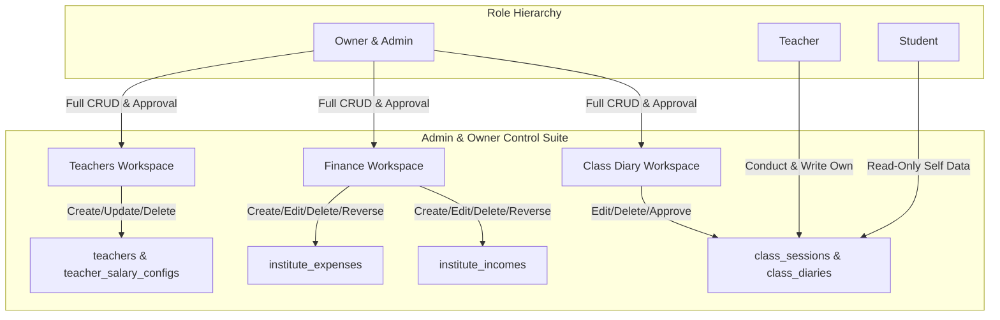

# Teacher Remuneration, Finance (Expenses & Incomes), and Class Diary Management Implementation Plan

> **For agentic workers:** REQUIRED SUB-SKILL: Use superpowers:subagent-driven-development (recommended) or superpowers:executing-plans to implement this plan task-by-task. Steps use checkbox (`- [ ]`) syntax for tracking.

**Goal:** Enable comprehensive management rights for institute administrators (Owner/Admin) to add teachers with their salary/income structure, full Add/Edit/Delete capabilities on both Expenses and Incomes, and full Edit/Delete actions for Class Diary records while restricting operational and view permissions for other roles.

**Architecture:**
- **Teacher & Remuneration Layer:** Expand `teachersService.ts` and `Teachers.tsx` to handle teacher profile creation/updates alongside `teacher_salary_configs` upserts (`monthly_fixed`, `per_lecture`, `hourly`) and teacher deletion with safety checks.
- **Finance Operations Layer (Expenses & Direct Incomes):** Expand `financeService.ts` with `updateExpense`, `deleteExpense`, `updateIncome`, and `deleteIncome`. Enhance `ExpenseModal` for edit mode, build `IncomeModal.tsx`, and convert `Expenses.tsx` into a dual-ledger workspace with tabs for **Operational Expenses** and **Direct Institute Incomes**.
- **Academic Diary Layer:** Add `updateClassDiary` and `deleteClassDiary` to `diaryService.ts`. Add interactive Edit and Delete actions to `ClassDiary.tsx` cards with role checks (Admin/Owner can edit/delete all, Teachers can edit their own, Students are read-only).

**Architecture Diagram:**

**Tech Stack:** React 18, TypeScript, Tailwind CSS, Supabase PostgreSQL, Lucide React.

---

## Global Constraints
- Target Institute: Pradeep Classes (`11111111-2222-3333-4444-555555555555`).
- Preserves existing append-only audited reversals while allowing authorized direct record edits and deletions.
- Zero mock or fallback arrays; all metrics, tables, and modals must link to Supabase PostgreSQL.
- Shell commands run in Windows PowerShell (use `;` for chaining commands, never `&&`).

---

## Tasks

### Task 1: Teacher Remuneration & Full Management
**Files:**
- `src/services/teachersService.ts`
- `src/pages/Teachers.tsx`
- `src/types/index.ts`

- [ ] **Step 1.1: Expand `teachersService.ts`**
  - Add support for salary payload in `createTeacher` (`salary_config?: { calculation_type: string; base_amount: number; per_lecture_rate: number }`).
  - Add `deleteTeacher(id: string): Promise<{ success: boolean; error?: string }>`.
  - Add `getTeacherSalaryConfig(teacherId: string)`.

- [ ] **Step 1.2: Upgrade `src/pages/Teachers.tsx`**
  - Add salary configuration fields to the "Add Teacher" modal:
    - Calculation Type (`monthly_fixed`, `per_lecture`, `hourly`)
    - Monthly Base Amount (INR)
    - Per Lecture Rate (INR)
  - Add salary configuration fields to the "Edit Teacher" modal.
  - Display salary badges (e.g. `₹45,000/mo` or `₹800/lec`) on teacher cards.
  - Add **Delete Teacher** button with safety confirmation modal.
  - Restrict add/edit/delete/salary actions strictly to `owner` and `admin`.

---

### Task 2: Expense Edit and Delete Actions
**Files:**
- `src/services/financeService.ts`
- `src/components/finance/ExpenseModal.tsx`
- `src/pages/Expenses.tsx`

- [ ] **Step 2.1: Implement `updateExpense` and `deleteExpense` in `financeService.ts`**
  - `updateExpense(id: string, payload: Partial<CreateExpensePayload>): Promise<InstituteExpense>`
  - `deleteExpense(id: string): Promise<void>`

- [ ] **Step 2.2: Upgrade `ExpenseModal.tsx` for Edit Mode**
  - Add `initialData?: InstituteExpense | null` prop.
  - Pre-fill category, amount, payment method, vendor name, description, and expense date when editing.
  - Call `updateExpense` on edit and `createExpense` on create.

- [ ] **Step 2.3: Upgrade `Expenses.tsx` Table Actions**
  - Add **Edit** action button (pencil icon) per expense row.
  - Add **Delete** action button (trash icon) per expense row with confirmation.
  - Wire actions to refresh the ledger and update KPI banners.

---

### Task 3: Institute Direct Income Management (Add, Edit, Delete, Reverse)
**Files:**
- `src/services/financeService.ts`
- `src/components/finance/IncomeModal.tsx`
- `src/pages/Expenses.tsx`
- `src/types/finance.ts`

- [ ] **Step 3.1: Implement Income Mutation Services**
  - Ensure `createIncome`, `updateIncome`, and `deleteIncome` are exported in `financeService.ts`.
  - Validate fields: `source_type`, `amount`, `payment_method`, `income_date`, `description`, `transaction_reference`.

- [ ] **Step 3.2: Create `IncomeModal.tsx`**
  - Modal with form for Source Category (Admission Fee, Books & Notes, Exam Fee, Lab Fee, Other), Amount, Date, Payment Method, Reference, and Description.
  - Supports both Create and Edit modes.

- [ ] **Step 3.3: Add Incomes Tab & Ledger in `Expenses.tsx`**
  - Add sub-tabs in `Expenses.tsx`: `[Operational Expenses]` & `[Direct Incomes]`.
  - In Incomes tab, render summary KPIs: Total Income, Approved Inflow, Filtered Inflow.
  - Render table of direct incomes with search, category filter, and row actions:
    - **Edit Income**
    - **Delete Income**
    - **Reverse Income** (with audit reason)
  - Add **Record Income** toolbar button.

---

### Task 4: Class Diary Editing and Deletion
**Files:**
- `src/services/diaryService.ts`
- `src/pages/ClassDiary.tsx`

- [ ] **Step 4.1: Implement Class Diary Mutations in `diaryService.ts`**
  - `updateClassDiary(sessionId: string, diaryId: string, dto: Partial<CreateClassDiaryDTO>): Promise<{ success: boolean; error?: string }>`
  - `deleteClassDiary(sessionId: string): Promise<{ success: boolean; error?: string }>`

- [ ] **Step 4.2: Upgrade `ClassDiary.tsx` Cards & Modal**
  - Add **Edit** action button to each Class Diary card.
  - Add **Delete** action button to each Class Diary card with confirmation.
  - Allow `RecordClassDiaryModal` to accept an existing session/diary to edit.
  - Restrict full delete/edit to `owner` and `admin`; allow teachers to edit their own entries only; students read-only.

---

### Task 5: Build Verification & Acceptance Testing
- [ ] **Step 5.1:** Run `npm.cmd run build` to confirm 0 TypeScript compiler errors.
- [ ] **Step 5.2:** Test database persistence for all actions.
- [ ] **Step 5.3:** Commit to `main` and push to Vercel production.
- [ ] **Step 5.4:** Update `task.md` and `walkthrough.md`.
