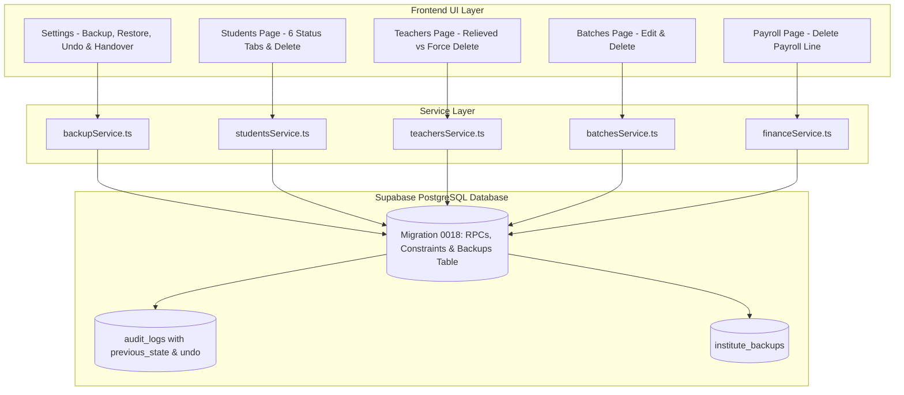

# Universal ERP Lifecycle, Crisis Recovery, Backup/Restore & Clean Handover Implementation Plan

> **For agentic workers:** REQUIRED SUB-SKILL: Use superpowers:subagent-driven-development (recommended) or superpowers:executing-plans to implement this plan task-by-task. Steps use checkbox (`- [ ]`) syntax for tracking.

**Goal:** Implement full lifecycle status management (Active, On-Hold, Alumni, Rusticated, Dropped-Out, Relieved), safe cascading deletions, automated backups/restores, actionable undo, and a clean-slate demo data purge so the institute can be handed over to Pradeep Classes with zero developer dependency.

**Architecture:** Database-backed via PostgreSQL RPCs in migration `0018` for atomic cascade deletions, backup exports/restores, and audit undos; frontend services in `src/services/` for backup and entity lifecycles; UI enhancements across `Students.tsx`, `Teachers.tsx`, `Batches.tsx`, `TeacherPayroll.tsx`, and `Settings.tsx`.

**Architecture Diagram:**



**Tech Stack:** React 18, TypeScript, Vite, Tailwind CSS, Supabase (PostgreSQL, RLS, RPCs, Auth, pgcrypto).

**Spec:** [docs/superpowers/specs/2026-11-22-erp-lifecycle-deactivation-deletion-and-clean-handover-design.md](file:///c:/Users/hp/OneDrive/Desktop/antigravity%20workspace/pradeep-classes-management/docs/superpowers/specs/2026-11-22-erp-lifecycle-deactivation-deletion-and-clean-handover-design.md)

## Global Constraints

- Never expose Supabase service-role key or provider secrets in client code.
- Every destructive operation must run through verified PostgreSQL RPCs with atomic transactions.
- Zero mock data or fabricated transactions.
- Never delete `super_admin`, `owner`, or `admin` accounts via cascade RPCs.
- Windows PowerShell compatibility (chain commands with `;`, never `&&`).

## Review Focus

1. **Cascade Blast Radius:** Ensure `admin_delete_teacher` and `admin_delete_student` only delete child records belonging to the target entity, never affecting other students/teachers.
2. **Session Preservation:** Ensure user cleanup unlinks without touching the active administrator's authentication session.
3. **Backup Atomicity:** Verify `admin_restore_institute_backup` runs in a transaction and captures an automated `pre_restore_snapshot` before executing.
4. **Audit State Capture:** Verify `previous_state` is captured accurately before modifying an entity so `admin_undo_audit_action` restores true original state.
5. **Canonical Status Mapping:** Verify `students.status` handles lowercase values (`active`, `on_hold`, `alumni`, `rusticated`, `dropped_out`, `archived`) without UI filter mismatch.

---

### Task 1: Database Migration `0018_erp_lifecycle_and_clean_handover.sql`

**Files:**
- Create: `supabase/migrations/0018_erp_lifecycle_and_clean_handover.sql`
- Create: `supabase/tests/erp_lifecycle_test.sql`

**Interfaces:**
- Produces:
  - Table: `institute_backups` with RLS.
  - Columns: `students.status_reason`, `students.status_changed_at`, `students.exit_date`, `teachers.status`, `teachers.status_reason`, `teachers.status_changed_at`, `teachers.relieving_date`, `audit_logs.previous_state`, `audit_logs.new_state`, `audit_logs.is_reverted`.
  - RPCs:
    - `admin_delete_student(p_student_id UUID, p_force_cascade BOOLEAN) -> jsonb`
    - `admin_delete_teacher(p_teacher_id UUID, p_force_cascade BOOLEAN) -> jsonb`
    - `admin_delete_batch(p_batch_id UUID, p_force_cascade BOOLEAN) -> jsonb`
    - `admin_delete_payroll_record(p_payroll_id UUID) -> jsonb`
    - `admin_export_institute_backup() -> jsonb`
    - `admin_restore_institute_backup(p_backup_json jsonb) -> jsonb`
    - `admin_undo_audit_action(p_audit_id UUID) -> jsonb`
    - `admin_purge_demo_data() -> jsonb`

- [ ] **Step 1: Write SQL migration `0018_erp_lifecycle_and_clean_handover.sql`**
  Include data normalization for existing statuses, column additions, `institute_backups` table, and all 8 RPC functions.
- [ ] **Step 2: Write test SQL script `supabase/tests/erp_lifecycle_test.sql`**
  Assert status constraint enforcement, cascade deletion guards, backup snapshot export, and demo purge safety.
- [ ] **Step 3: Execute migration and test script against live Supabase instance**
  Run via Supabase MCP `execute_sql`.
- [ ] **Step 4: Commit**
  ```bash
  git add supabase/migrations/0018_erp_lifecycle_and_clean_handover.sql supabase/tests/erp_lifecycle_test.sql
  git commit -m "feat(db): add 0018 erp lifecycle, cascade deletions, backup/restore, and demo purge RPCs"
  ```

---

### Task 2: Backup & Recovery Service (`backupService.ts`) & Types

**Files:**
- Create: `src/types/backup.ts`
- Create: `src/services/backupService.ts`
- Create: `src/tests/backupService.test.ts`
- Modify: `package.json` (add `"test:backup": "npx tsx src/tests/backupService.test.ts"`)

**Interfaces:**
- Produces:
  - `backupService.exportBackup(): Promise<{ data?: InstituteBackupSnapshot; error?: string }>`
  - `backupService.downloadBackupFile(): Promise<void>`
  - `backupService.restoreBackup(json: any): Promise<{ success: boolean; error?: string }>`
  - `backupService.listBackups(): Promise<{ data: InstituteBackupRow[]; error?: string }>`
  - `backupService.undoAuditAction(auditId: string): Promise<{ success: boolean; error?: string }>`

- [ ] **Step 1: Write `src/types/backup.ts`**
  Define `InstituteBackupSnapshot`, `InstituteBackupRow`, `BackupType`.
- [ ] **Step 2: Write unit tests in `src/tests/backupService.test.ts`**
  Test JSON validation, RPC payload dispatch, and download link generation.
- [ ] **Step 3: Implement `src/services/backupService.ts`**
- [ ] **Step 4: Run unit tests**
  `npm run test:backup` (verify 100% pass).
- [ ] **Step 5: Commit**
  ```bash
  git add src/types/backup.ts src/services/backupService.ts src/tests/backupService.test.ts package.json
  git commit -m "feat(services): add backup, restore, and audit undo service with unit tests"
  ```

---

### Task 3: Entity Service Layer Updates for Multi-Status & Cascade Deletions

**Files:**
- Modify: `src/types/institute.ts` (update Student and Teacher interfaces)
- Modify: `src/services/teachersService.ts`
- Modify: `src/services/studentsService.ts`
- Modify: `src/services/batchesService.ts`
- Modify: `src/services/financeService.ts`
- Create: `src/tests/erpLifecycleServices.test.ts`
- Modify: `package.json` (add `"test:lifecycle": "npx tsx src/tests/erpLifecycleServices.test.ts"`)

**Interfaces:**
- Produces:
  - `teachersService.deleteTeacher(id: string, forceCascade?: boolean)`
  - `teachersService.updateTeacherStatus(id: string, status: TeacherStatus, reason?: string, date?: string)`
  - `studentsService.deleteStudent(id: string, forceCascade?: boolean)`
  - `studentsService.updateStudentStatus(id: string, status: StudentStatus, reason?: string, date?: string)`
  - `batchesService.deleteBatch(id: string, forceCascade?: boolean)`
  - `financeService.deleteTeacherPayroll(payrollId: string)`

- [ ] **Step 1: Update `src/types/institute.ts` with new statuses**
  `StudentStatus = 'active' | 'on_hold' | 'alumni' | 'rusticated' | 'dropped_out' | 'archived'`
  `TeacherStatus = 'active' | 'on_leave' | 'relieved'`
- [ ] **Step 2: Write unit tests in `src/tests/erpLifecycleServices.test.ts`**
- [ ] **Step 3: Update `teachersService.ts`, `studentsService.ts`, `batchesService.ts`, `financeService.ts`**
  Wire RPC calls `admin_delete_teacher`, `admin_delete_student`, `admin_delete_batch`, `admin_delete_payroll_record`.
- [ ] **Step 4: Run unit tests**
  `npm run test:lifecycle`
- [ ] **Step 5: Commit**
  ```bash
  git add src/types/institute.ts src/services/teachersService.ts src/services/studentsService.ts src/services/batchesService.ts src/services/financeService.ts src/tests/erpLifecycleServices.test.ts package.json
  git commit -m "feat(services): wire cascade deletions, status transitions, and payroll deletion"
  ```

---

### Task 4: Teachers Page Lifecycle Overhaul (`Teachers.tsx`)

**Files:**
- Modify: `src/pages/Teachers.tsx`
- Create: `src/components/teachers/TeacherStatusModal.tsx`
- Create: `src/components/teachers/TeacherDeleteModal.tsx`
- Create: `src/tests/teacherLifecycleUi.test.ts`
- Modify: `package.json` (add `"test:teachers-ui": "npx tsx src/tests/teacherLifecycleUi.test.ts"`)

**Interfaces:**
- Produces:
  - Status pills in `Teachers.tsx`: `Active Faculty`, `On Leave`, `Relieved / Resigned`.
  - Delete modal providing Choice A (*"Mark as Relieved / Resigned"*) vs Choice B (*"Permanently Delete Faculty & Purge Records"*).
  - Quick action to update status with notes and date.

- [ ] **Step 1: Write `TeacherStatusModal.tsx` and `TeacherDeleteModal.tsx`**
- [ ] **Step 2: Update `Teachers.tsx`**
  Replace hard delete error block with the new `TeacherDeleteModal` and add `TeacherStatusModal`.
- [ ] **Step 3: Write UI tests in `src/tests/teacherLifecycleUi.test.ts`**
- [ ] **Step 4: Run tests & verify**
  `npm run test:teachers-ui`
- [ ] **Step 5: Commit**
  ```bash
  git add src/pages/Teachers.tsx src/components/teachers/TeacherStatusModal.tsx src/components/teachers/TeacherDeleteModal.tsx src/tests/teacherLifecycleUi.test.ts package.json
  git commit -m "feat(teachers): add faculty status modal, relieved categorization, and dual-action delete modal"
  ```

---

### Task 5: Students Page Multi-Status Hub & Cascade Deletion (`Students.tsx`)

**Files:**
- Modify: `src/pages/Students.tsx`
- Create: `src/components/students/StudentStatusModal.tsx`
- Create: `src/components/students/StudentDeleteModal.tsx`
- Create: `src/tests/studentLifecycleUi.test.ts`
- Modify: `package.json` (add `"test:students-ui": "npx tsx src/tests/studentLifecycleUi.test.ts"`)

**Interfaces:**
- Produces:
  - Status filter tabs: `All Students`, `Active`, `On Hold`, `Alumni / Passed Out`, `Rusticated / Suspended`, `Dropped Out`, `Archived`.
  - Student status modal for transition to Alumni, Rusticated, Dropped Out.
  - Student delete modal offering "Soft Archive" vs "Permanent Force Delete" (requires typing "DELETE").

- [ ] **Step 1: Write `StudentStatusModal.tsx` and `StudentDeleteModal.tsx`**
- [ ] **Step 2: Update `Students.tsx`**
  Add status tabs, integrate `StudentStatusModal` and `StudentDeleteModal`.
- [ ] **Step 3: Write UI tests in `src/tests/studentLifecycleUi.test.ts`**
- [ ] **Step 4: Run tests & verify**
  `npm run test:students-ui`
- [ ] **Step 5: Commit**
  ```bash
  git add src/pages/Students.tsx src/components/students/StudentStatusModal.tsx src/components/students/StudentDeleteModal.tsx src/tests/studentLifecycleUi.test.ts package.json
  git commit -m "feat(students): add 6-status tabs, status change modal, and cascade delete modal"
  ```

---

### Task 6: Batches & Payroll Self-Service Management (`Batches.tsx` & `TeacherPayroll.tsx`)

**Files:**
- Modify: `src/pages/Batches.tsx`
- Modify: `src/pages/TeacherPayroll.tsx`
- Create: `src/tests/batchesAndPayrollLifecycle.test.ts`
- Modify: `package.json` (add `"test:batches-payroll": "npx tsx src/tests/batchesAndPayrollLifecycle.test.ts"`)

**Interfaces:**
- Produces:
  - `Batches.tsx`: Edit Batch and Delete Batch with student unassign warning.
  - `TeacherPayroll.tsx`: Trash / Delete icon on each payroll row with confirmation.

- [ ] **Step 1: Write tests in `src/tests/batchesAndPayrollLifecycle.test.ts`**
- [ ] **Step 2: Update `Batches.tsx` with Edit and Delete actions**
- [ ] **Step 3: Update `TeacherPayroll.tsx` with Delete payroll row action**
- [ ] **Step 4: Run tests & verify**
  `npm run test:batches-payroll`
- [ ] **Step 5: Commit**
  ```bash
  git add src/pages/Batches.tsx src/pages/TeacherPayroll.tsx src/tests/batchesAndPayrollLifecycle.test.ts package.json
  git commit -m "feat(admin): add self-service batch deletion/edit and payroll sheet deletion"
  ```

---

### Task 7: Backup, Crisis Recovery & Clean Handover Hub in Settings (`Settings.tsx`)

**Files:**
- Create: `src/components/settings/BackupAndRecoveryTab.tsx`
- Modify: `src/pages/Settings.tsx`
- Create: `src/tests/backupAndHandoverUi.test.ts`
- Modify: `package.json` (add `"test:backup-ui": "npx tsx src/tests/backupAndHandoverUi.test.ts"`)

**Interfaces:**
- Produces:
  - New tab in `Settings.tsx`: **"Backup, Crisis Recovery & Handover"**.
  - 1-click Download Backup (.json).
  - Restore Backup file uploader with confirmation.
  - Activity history with 1-click "Undo Action".
  - Owner-only "Purge Demo Data & Reset to Clean Slate" requiring typing "PURGE DEMO DATA".

- [ ] **Step 1: Write `BackupAndRecoveryTab.tsx`**
- [ ] **Step 2: Integrate into `Settings.tsx`**
- [ ] **Step 3: Write tests in `src/tests/backupAndHandoverUi.test.ts`**
- [ ] **Step 4: Run tests & verify**
  `npm run test:backup-ui`
- [ ] **Step 5: Commit**
  ```bash
  git add src/components/settings/BackupAndRecoveryTab.tsx src/pages/Settings.tsx src/tests/backupAndHandoverUi.test.ts package.json
  git commit -m "feat(settings): add backup, crisis recovery, audit undo, and clean handover console"
  ```

---

### Task 8: Full Verification, Clean Handover Execution & Production Deployment

**Files:**
- All created and modified files.

- [ ] **Step 1: Run all test suites across the project**
  `npm run test:users ; npm run test:users-ui ; npm run test:auth ; npm run test:pwa ; npm run test:onboarding ; npm run test:backup ; npm run test:lifecycle ; npm run test:teachers-ui ; npm run test:students-ui ; npm run test:batches-payroll ; npm run test:backup-ui`
- [ ] **Step 2: Run complete production build**
  `npm run build`
- [ ] **Step 3: Execute clean slate demo purge on database (preserving institute config & admin login)**
  Execute `admin_purge_demo_data()` via Supabase MCP to guarantee an empty, pristine state ready for real onboarding.
- [ ] **Step 4: Push to `main` branch to trigger Vercel deployment**
  `git push origin main`
- [ ] **Step 5: Verify live production deployment on `https://app.pradeepclasses.in`**
