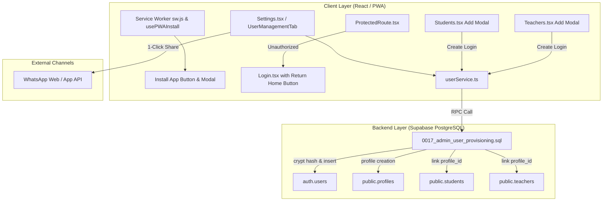

# PWA Mobile Suite, Admin User Provisioning Hub & Smart Unauthorized Redirect Implementation Plan

> **For agentic workers:** REQUIRED SUB-SKILL: Use superpowers:subagent-driven-development (recommended) or superpowers:executing-plans to implement this plan task-by-task. Steps use checkbox (`- [ ]`) syntax for tracking.

**Goal:** Transform the Pradeep Classes platform into an accessible, multi-device Coaching ERP by adding full PWA mobile installation, seamless unauthorized redirect to `/login` with 1-click workspace return, and an Admin User Management Hub with direct student/faculty credential provisioning and WhatsApp dispatch.

**Architecture:** 
1. Database migration `0017` introduces transactional `SECURITY DEFINER` RPCs (`admin_list_institute_users`, `admin_create_institute_user`, `admin_reset_user_password`, `admin_toggle_user_status`) using PostgreSQL `crypt()` password hashing to provision `auth.users` without logging out the administrator.
2. `ProtectedRoute.tsx` and `Login.tsx` intercept unauthorized route attempts, redirecting to `/login` with friendly role-awareness and a prominent "Return to Authorized Workspace" button.
3. A Progressive Web App suite (`public/sw.js`, `usePWAInstall.ts`, `PWAInstallPrompt.tsx`) provides offline asset caching and 1-click install banners on Android, iOS Safari, and Desktop.
4. User Management is integrated into `Settings.tsx` alongside inline onboarding checkboxes in `Students.tsx` and `Teachers.tsx` with 1-click WhatsApp credentials dispatch.

**Architecture Diagram:**



**Tech Stack:** React 18, TypeScript, Vite, Tailwind CSS, Supabase (PostgreSQL, Auth, RLS, RPCs), Service Worker API, Web App Manifest.

**Spec:** [docs/superpowers/specs/2026-11-22-pwa-user-management-unauthorized-redirect-design.md](file:///c:/Users/hp/OneDrive/Desktop/antigravity%20workspace/pradeep-classes-management/docs/superpowers/specs/2026-11-22-pwa-user-management-unauthorized-redirect-design.md)

## Global Constraints

- Institute Tenancy: All user operations are strictly scoped to Institute ID `11111111-2222-3333-4444-555555555555` (or caller's tenant).
- Secret Protection: Never expose Supabase `service_role` keys in client-side code; all administrative user creation must go through `SECURITY DEFINER` RPCs.
- No Admin Logout: Creating student or teacher accounts must never disrupt or invalidate the active Admin/Owner session.
- Synthetic Username Rule: If a student lacks an email, the username defaults to `{admission_no}@pradeepclasses.in` so they can log in via Admission Number.
- Offline Safety: Offline capabilities are strictly read-only; mutation forms (fees, attendance) require live connectivity and display an alert banner when offline.

## Review Focus

1. **Session Disruption Guard:** Admin creates a new user account; verify the admin remains fully authenticated on their dashboard without being signed out.
2. **Unauthorized Route Redirect:** Student clicks or enters `/fees`; verify they land on `/login` with an alert message and a visible "Return to Student Portal" button rather than a dead-end 403 screen.
3. **PWA Standalone & iOS Safari Handling:** Verify the install button handles both native `beforeinstallprompt` (Chrome/Android) and shows visual "Add to Home Screen" instructions on iOS.
4. **Duplicate Email / Admission Number Collision:** RPC handles duplicate email or admission number gracefully with a readable error message instead of an unhandled DB exception.
5. **Deactivated Account Block:** When an admin toggles a user's status to `is_active = false`, verify they are blocked from logging in or using the portal.

---

### Task 1: Database Migration `0017_admin_user_provisioning.sql`

**Files:**
- Create: `supabase/migrations/0017_admin_user_provisioning.sql`
- Test: `supabase/tests/admin_user_provisioning_test.sql`

**Interfaces:**
- Produces: 
  - `public.admin_list_institute_users()` returns table of users with credentials metadata.
  - `public.admin_create_institute_user(p_email, p_password, p_full_name, p_role, p_student_id, p_teacher_id, p_phone)` returns `jsonb`.
  - `public.admin_reset_user_password(p_user_id, p_new_password)` returns `jsonb`.
  - `public.admin_toggle_user_status(p_user_id, p_is_active)` returns `jsonb`.

- [ ] **Step 1: Write the failing SQL migration test**

Define test queries verifying:
- Non-admin calling `admin_create_institute_user` raises 'Unauthorized'.
- Admin calling `admin_create_institute_user` inserts into `auth.users` with bcrypt hash and updates `profiles`.
- Linking `p_student_id` updates `students.profile_id`.
- `admin_list_institute_users` lists user records with tenant filtering.

- [ ] **Step 2: Run test to verify it fails**

Verify database throws missing function error for `admin_create_institute_user`.

- [ ] **Step 3: Implement `0017_admin_user_provisioning.sql`**

```sql
-- 0017_admin_user_provisioning.sql
ALTER TABLE public.profiles ADD COLUMN IF NOT EXISTS is_active BOOLEAN NOT NULL DEFAULT true;

-- RPC 1: List Users
CREATE OR REPLACE FUNCTION public.admin_list_institute_users()
RETURNS TABLE (
  id uuid,
  email text,
  full_name text,
  role text,
  phone text,
  is_active boolean,
  created_at timestamptz,
  linked_student_id uuid,
  linked_student_name text,
  linked_admission_no text,
  linked_teacher_id uuid,
  linked_teacher_name text
)
LANGUAGE plpgsql
SECURITY DEFINER
SET search_path = public, auth, extensions
AS $$
...
$$;

-- RPC 2: Create User
CREATE OR REPLACE FUNCTION public.admin_create_institute_user(
  p_email text,
  p_password text,
  p_full_name text,
  p_role text,
  p_student_id uuid DEFAULT NULL,
  p_teacher_id uuid DEFAULT NULL,
  p_phone text DEFAULT NULL
)
RETURNS jsonb
LANGUAGE plpgsql
SECURITY DEFINER
SET search_path = public, auth, extensions
AS $$
...
$$;

-- RPC 3: Reset Password
CREATE OR REPLACE FUNCTION public.admin_reset_user_password(
  p_user_id uuid,
  p_new_password text
)
RETURNS jsonb
LANGUAGE plpgsql
SECURITY DEFINER
SET search_path = public, auth, extensions
AS $$
...
$$;

-- RPC 4: Toggle Status
CREATE OR REPLACE FUNCTION public.admin_toggle_user_status(
  p_user_id uuid,
  p_is_active boolean
)
RETURNS jsonb
LANGUAGE plpgsql
SECURITY DEFINER
SET search_path = public
AS $$
...
$$;

GRANT EXECUTE ON FUNCTION public.admin_list_institute_users() TO authenticated;
GRANT EXECUTE ON FUNCTION public.admin_create_institute_user(text, text, text, text, uuid, uuid, text) TO authenticated;
GRANT EXECUTE ON FUNCTION public.admin_reset_user_password(uuid, text) TO authenticated;
GRANT EXECUTE ON FUNCTION public.admin_toggle_user_status(uuid, boolean) TO authenticated;
```

- [ ] **Step 4: Apply migration and verify tests pass**

Execute migration on Supabase and confirm RPC execution grants and tables.

- [ ] **Step 5: Commit**

```bash
git add supabase/migrations/0017_admin_user_provisioning.sql
git commit -m "feat(db): add 0017 admin user provisioning RPCs with pgcrypto password hashing"
```

---

### Task 2: User Service & Types

**Files:**
- Create: `src/types/user.ts`
- Create: `src/services/userService.ts`
- Create: `src/tests/userService.test.ts`

**Interfaces:**
- Consumes: Supabase client RPCs from Task 1.
- Produces: 
  - `userService.listInstituteUsers(): Promise<{ data: InstituteUser[], error?: string }>`
  - `userService.createInstituteUser(dto: CreateUserDTO): Promise<{ data: InstituteUser | null, error?: string }>`
  - `userService.resetUserPassword(dto: ResetPasswordDTO): Promise<{ success: boolean, error?: string }>`
  - `userService.toggleUserStatus(userId: string, isActive: boolean): Promise<{ success: boolean, error?: string }>`

- [ ] **Step 1: Write unit tests in `src/tests/userService.test.ts`**

Mock Supabase RPC responses and assert correct payload formatting and error handling.

- [ ] **Step 2: Run test to verify it fails**

Run: `npm test -- src/tests/userService.test.ts` (or verify TypeScript build fails on missing types).

- [ ] **Step 3: Implement `src/types/user.ts` and `src/services/userService.ts`**

Define interfaces:
- `InstituteUser`: id, email, full_name, role, phone, is_active, created_at, linked_student, linked_teacher.
- `CreateUserDTO`: email, password, full_name, role, student_id?, teacher_id?, phone?.
- Implement methods calling `supabase.rpc("admin_list_institute_users")`, etc.

- [ ] **Step 4: Verify test passes and TypeScript compiles**

Run test runner or verify compilation.

- [ ] **Step 5: Commit**

```bash
git add src/types/user.ts src/services/userService.ts src/tests/userService.test.ts
git commit -m "feat(users): add user management service and TypeScript types"
```

---

### Task 3: Smart Unauthorized Redirect & Login Flow

**Files:**
- Modify: `src/routes/ProtectedRoute.tsx:35-43`
- Modify: `src/pages/Login.tsx:15-120`
- Modify: `src/pages/Unauthorized.tsx:1-40`

**Interfaces:**
- Consumes: React Router `useLocation()`, `useNavigate()`, `useAuth()`.
- Produces: Clean redirect to `/login` with `state: { from, unauthorized: true, requiredRoles, currentRole }`.

- [ ] **Step 1: Write test for ProtectedRoute role mismatch redirect**

Verify `ProtectedRoute` redirects unauthorized authenticated user to `/login` with `unauthorized: true` in state instead of `/unauthorized`.

- [ ] **Step 2: Update `src/routes/ProtectedRoute.tsx`**

```tsx
  // Role authorization check: redirect directly to login with context
  if (allowedRoles && allowedRoles.length > 0 && !allowedRoles.includes(role)) {
    return (
      <Navigate
        to="/login"
        state={{
          from: location,
          unauthorized: true,
          requiredRoles: allowedRoles,
          currentRole: role,
        }}
        replace
      />
    );
  }
```

- [ ] **Step 3: Update `src/pages/Login.tsx` with Role Banner & Return Button**

When `location.state?.unauthorized` is true:
- Show alert banner: *"Access Restricted: You are currently signed in as '{currentRole}'. That section requires {requiredRoles.join(' or ')} clearance."*
- Render prominent button: *"← Return to My Authorized Portal"* routing to `/portal` for student, `/platform` for super admin, `/dashboard` for staff.
- Keep login fields active below for switching accounts.

- [ ] **Step 4: Verify in browser / build**

Verify navigating to an unauthorized route seamlessly presents the login banner and 1-click return button.

- [ ] **Step 5: Commit**

```bash
git add src/routes/ProtectedRoute.tsx src/pages/Login.tsx src/pages/Unauthorized.tsx
git commit -m "feat(auth): redirect unauthorized access to login with return workspace action"
```

---

### Task 4: PWA Service Worker, Manifest & Mobile Install Suite

**Files:**
- Create: `public/sw.js`
- Modify: `public/manifest.json`
- Create: `src/hooks/usePWAInstall.ts`
- Create: `src/components/common/PWAInstallPrompt.tsx`
- Modify: `src/components/layout/Topbar.tsx`
- Modify: `src/main.tsx`

**Interfaces:**
- Produces:
  - `usePWAInstall()` exposing `{ isInstallable, isInstalled, isIOS, isStandalone, triggerInstall }`.
  - `PWAInstallPrompt` component in `Topbar.tsx` with install trigger button and modal guide.

- [ ] **Step 1: Implement `public/sw.js`**

Implement cache-first for static icons/CSS/JS with network-first for Supabase API calls.

- [ ] **Step 2: Register Service Worker in `src/main.tsx`**

Register `sw.js` in production with log confirmation.

- [ ] **Step 3: Implement `src/hooks/usePWAInstall.ts`**

Listen to `window.addEventListener("beforeinstallprompt")`, store `deferredPrompt`, detect iOS Safari user agent, and export install trigger.

- [ ] **Step 4: Create `PWAInstallPrompt.tsx` and integrate in `Topbar.tsx`**

- Sleek topbar pill: `📲 Install App` (with subtle pulse animation).
- Click opens modal:
  - Android/Chrome/Edge: Direct "Install Now" button triggering `deferredPrompt.prompt()`.
  - iOS Safari: Visual 3-step guide: "1. Tap Share icon, 2. Scroll & tap 'Add to Home Screen', 3. Tap 'Add'".
  - Desktop: Explains standalone window experience.

- [ ] **Step 5: Verify build & commit**

```bash
git add public/sw.js public/manifest.json src/hooks/usePWAInstall.ts src/components/common/PWAInstallPrompt.tsx src/components/layout/Topbar.tsx src/main.tsx
git commit -m "feat(pwa): add service worker, installation hook, and topbar install modal"
```

---

### Task 5: Admin User Management Hub in Settings

**Files:**
- Create: `src/components/users/UserManagementTab.tsx`
- Modify: `src/pages/Settings.tsx`

**Interfaces:**
- Consumes: `userService` from Task 2.
- Produces: Full UI for listing institute accounts, creating new users, resetting passwords, and dispatching WhatsApp credentials.

- [ ] **Step 1: Build `UserManagementTab.tsx`**

Features:
- Filter by role (All, Teachers, Students, Admins) and search by name/email/phone.
- Account list table showing Full Name, Username/Email, Role badge, Linked Record, Active Status badge, Actions.
- **"Create New User" Modal**:
  - Full Name, Email (optional for student, auto-generates Admission No email), Role, Password (with "Generate Secure Password" generator button), Phone.
  - Links to existing student or teacher if selected.
  - On submit: calls `userService.createInstituteUser`.
  - Shows success popup with:
    - Username, Password, Portal Link.
    - **"Copy Credentials"** button.
    - **"Send via WhatsApp"** button (`https://wa.me/{phone}?text=...`).
- **"Reset Password" Modal**:
  - Allows admin to set or auto-generate a new password and immediately send via WhatsApp.
- **Toggle Status**:
  - Deactivate / Activate user with instant UI feedback.

- [ ] **Step 2: Integrate User Management Tab into `src/pages/Settings.tsx`**

Add Tab: `User Accounts & Logins` (accessible to `owner`, `admin`, `super_admin`).

- [ ] **Step 3: Verify TypeScript compilation**

Run `npm run build` and ensure clean bundle.

- [ ] **Step 4: Commit**

```bash
git add src/components/users/UserManagementTab.tsx src/pages/Settings.tsx
git commit -m "feat(settings): add admin user management console with WhatsApp credentials sharing"
```

---

### Task 6: Inline User Creation in Student & Teacher Registration

**Files:**
- Modify: `src/pages/Students.tsx`
- Modify: `src/pages/Teachers.tsx`

**Interfaces:**
- Consumes: `userService.createInstituteUser`, `studentsService`, `teachersService`.
- Produces: Seamless 1-step registration where saving a student or teacher also creates their portal login and displays the WhatsApp credential card.

- [ ] **Step 1: Add "Generate Portal Login" in `Students.tsx`**

In the "Register New Student" modal:
- Add checkbox: ☑️ *"Generate Student Portal Login Account"*.
- When checked:
  - Generates secure temporary password.
  - If student email is empty, displays preview username: `{admission_no}@pradeepclasses.in`.
- On form submit:
  - Saves student record via `studentsService.createStudent`.
  - Calls `userService.createInstituteUser` linking the new student `id`.
  - Shows Credentials Modal with 1-click **"Send Welcome WhatsApp to Student / Parent"**.

- [ ] **Step 2: Add Email & "Generate Portal Login" in `Teachers.tsx`**

In the "Add Faculty Member" modal:
- Add optional Email field.
- Add checkbox: ☑️ *"Generate Faculty Portal Login Account"*.
- When checked, generates password and calls `userService.createInstituteUser` linking the new teacher `id`.
- Shows Credentials Modal with 1-click **"Send Faculty Portal Access via WhatsApp"**.

- [ ] **Step 3: Verify in development / run build**

Test registering a student with credentials creation; verify no admin logout occurs and credentials popup opens.

- [ ] **Step 4: Commit**

```bash
git add src/pages/Students.tsx src/pages/Teachers.tsx
git commit -m "feat(onboarding): add inline user login provisioning to student and teacher registration"
```

---

### Task 7: Full Verification, Production Build & Live Deployment

**Files:**
- All modified and created files.

- [ ] **Step 1: Execute database migration `0017` on live Supabase instance**
- [ ] **Step 2: Run complete production build `npm run build`**
- [ ] **Step 3: Commit and push to `main` branch to trigger Vercel deployment**
- [ ] **Step 4: Verify production deployment on `https://app.pradeepclasses.in`**
  - Verify PWA install button in Topbar.
  - Verify unauthorized redirect flow to `/login`.
  - Verify User Management tab in Settings.
  - Verify Student & Teacher credential generation and WhatsApp link formatting.
