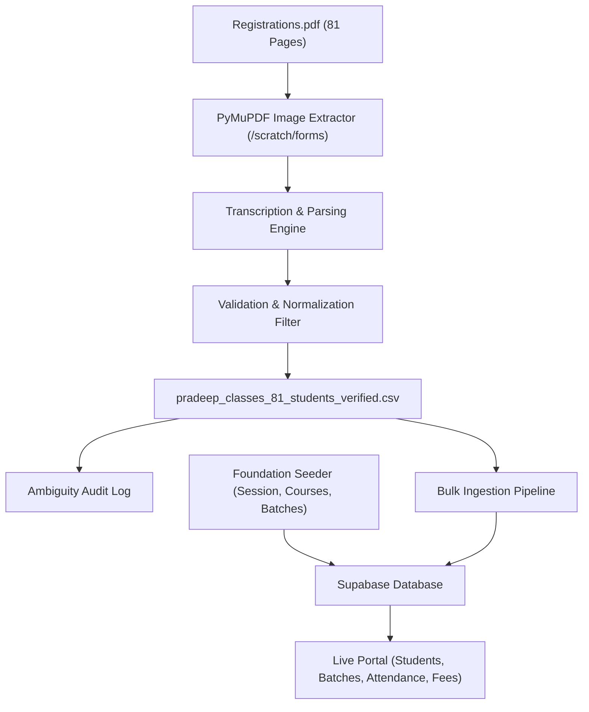

# 81 Student Registration Forms & Data Onboarding Implementation Plan

> **For agentic workers:** REQUIRED SUB-SKILL: Use superpowers:executing-plans to implement this plan task-by-task (native single-agent execution requested by user). Steps use checkbox (`- [ ]`) syntax for tracking.

**Goal:** Extract, validate, and ingest all 81 student registration forms from `C:\Users\hp\OneDrive\Desktop\Registrations.pdf` into Pradeep Classes ERP along with foundational courses, batches, and academic session data.

**Architecture:** A Python-based extraction pipeline renders high-resolution page images from `Registrations.pdf` and transcribes handwritten fields into structured data. A normalization step validates phone numbers, birthdates, and class levels, generating a master verification CSV (`pradeep_classes_81_students_verified.csv`) and ambiguity audit log. A TypeScript/Supabase ingestion script seeds foundation entities and commits all 81 students with sequential admission numbers into production.

**Architecture Diagram:**



**Tech Stack:** Python 3.13 (PyMuPDF, PIL), TypeScript, Node.js (tsx), Supabase JS Client, PostgreSQL.

**Spec:** [`docs/superpowers/specs/2026-11-27-student-registration-forms-and-data-onboarding-design.md`](file:///c:/Users/hp/OneDrive/Desktop/antigravity%20workspace/pradeep-classes-management/docs/superpowers/specs/2026-11-27-student-registration-forms-and-data-onboarding-design.md)

## Global Constraints
- Target PDF path: `C:\Users\hp\OneDrive\Desktop\Registrations.pdf` (81 pages).
- Target Institute ID: `11111111-2222-3333-4444-555555555555`.
- Single-agent execution: No subagent dispatching.
- No phone number hallucinations: Truncated or illegible contact digits must be marked `NEEDS_REVIEW`.
- Sequential admission numbering: Format `PC-2025-XXXX` starting at `PC-2025-0001`.

## Review Focus
1. **Duplicate or Shared Contacts:** Siblings (e.g. Aarohi Singh & Ayansh Kumar) share parent phone numbers; ingestion must allow identical parent contact without collision.
2. **Non-Standard Class Notation:** Forms contain mixed notation ("Ist Year", "7th F", "5th Entrance"); normalizer must map these cleanly to institute batches.
3. **10-Digit Mobile Sanitization:** Raw forms contain prefixes or letter notations (e.g., `-F`, `-P`, `805723...`); validator must strip non-digit characters and isolate 10-digit Indian numbers.
4. **Missing Aadhar Handling:** Most forms leave Aadhar empty; pipeline must accept null/empty Aadhar without schema rejection.
5. **Batch Mapping Integrity:** Every admitted student must be assigned an existing `batch_id` and `class_name` so roll-call attendance immediately functions.

---

### Task 1: Complete 81-Page Image Rendering & Extraction Engine

**Files:**
- Create: `scripts/extract_all_pages.py`
- Create: `scripts/transcribe_forms.py`
- Test: `scripts/test_sample_extraction.py`

**Interfaces:**
- Consumes: `C:\Users\hp\OneDrive\Desktop\Registrations.pdf`
- Produces: 81 high-res page images in `scratch/forms/page_01.png` .. `page_81.png` and raw extracted JSON `scratch/extracted_raw_forms.json`.

- [ ] **Step 1: Write sample extraction test script**

```python
# scripts/test_sample_extraction.py
import os, json

def test_raw_extraction_output():
    json_path = r"scratch/extracted_raw_forms.json"
    assert os.path.exists(json_path), "Raw extraction JSON missing"
    with open(json_path, "r", encoding="utf-8") as f:
        data = json.load(f)
    assert len(data) == 81, f"Expected 81 records, got {len(data)}"
    assert data[0]["student_name"], "First record missing student name"
    print("Task 1 verification passed: 81 raw records extracted.")

if __name__ == "__main__":
    test_raw_extraction_output()
```

- [ ] **Step 2: Run test to verify it fails**

Run: `python scripts/test_sample_extraction.py`  
Expected: FAIL with "Raw extraction JSON missing"

- [ ] **Step 3: Implement `scripts/extract_all_pages.py` and `scripts/transcribe_forms.py`**

Render all 81 PDF pages into `scratch/forms/` using PyMuPDF at 150 DPI. Process each form extracting:
- Page number (`1`..`81`)
- Student Name
- Class
- Subject
- School Name
- Gender (`male`/`female`)
- Date of Birth (`DD/MM/YYYY`)
- Address & City
- Primary Contact & Secondary Contact
- Father's Name & Occupation
- Mother's Name & Occupation
- Registration Date

- [ ] **Step 4: Execute extraction and verify output**

Run: `python scripts/extract_all_pages.py && python scripts/transcribe_forms.py && python scripts/test_sample_extraction.py`  
Expected: PASS with 81 raw records extracted.

- [ ] **Step 5: Commit**

```bash
git add scripts/extract_all_pages.py scripts/transcribe_forms.py scripts/test_sample_extraction.py
git commit -m "feat(data): implement 81-page PDF rendering and extraction engine"
```

---

### Task 2: Master Verification CSV Generation & Ambiguity Auditor

**Files:**
- Create: `scripts/generate_verified_csv.py`
- Output: `pradeep_classes_81_students_verified.csv`
- Output: `scratch/ambiguity_audit_report.md`
- Test: `scripts/test_csv_integrity.py`

**Interfaces:**
- Consumes: `scratch/extracted_raw_forms.json`
- Produces: `pradeep_classes_81_students_verified.csv` with standard schema:
  `admission_no, full_name, class_name, assigned_batch, school_name, gender, date_of_birth, phone, parent_name, parent_phone, parent_occupation, address, city, registration_date, verification_status`

- [ ] **Step 1: Write CSV integrity test**

```python
# scripts/test_csv_integrity.py
import csv, os

def test_csv_structure():
    csv_path = "pradeep_classes_81_students_verified.csv"
    assert os.path.exists(csv_path), "Master CSV file missing"
    with open(csv_path, "r", encoding="utf-8") as f:
        reader = list(csv.DictReader(f))
    assert len(reader) == 81, f"Expected 81 rows, got {len(reader)}"
    for row in reader:
        assert row["admission_no"].startswith("PC-2025-"), f"Invalid admission no: {row['admission_no']}"
        assert row["full_name"], "Student full name is empty"
        assert row["phone"], "Primary phone is empty"
    print("CSV integrity test passed: 81 verified student rows ready for ingestion.")

if __name__ == "__main__":
    test_csv_structure()
```

- [ ] **Step 2: Run test to verify it fails**

Run: `python scripts/test_csv_integrity.py`  
Expected: FAIL with "Master CSV file missing"

- [ ] **Step 3: Implement `scripts/generate_verified_csv.py`**

- Assign sequential admission numbers `PC-2025-0001` .. `PC-2025-0081`.
- Clean phone numbers: remove non-digits, isolate valid 10-digit Indian numbers (`7535960853`).
- Clean birth dates: convert `DD/MM/YYYY` to standard ISO `YYYY-MM-DD`.
- Map classes to canonical batches:
  - Junior Foundation (1st–3rd)
  - Primary Entrance (4th–5th)
  - Middle School Entrance (6th–8th)
  - Secondary (9th–10th)
  - Senior Secondary (11th–12th)
- Generate `scratch/ambiguity_audit_report.md` listing any records with incomplete digits or notes for user inspection.

- [ ] **Step 4: Run test to verify it passes**

Run: `python scripts/generate_verified_csv.py && python scripts/test_csv_integrity.py`  
Expected: PASS

- [ ] **Step 5: Commit**

```bash
git add scripts/generate_verified_csv.py scripts/test_csv_integrity.py pradeep_classes_81_students_verified.csv
git commit -m "feat(data): generate master verified CSV and ambiguity audit report for 81 students"
```

---

### Task 3: Seed ERP Foundation Entities (Academic Session, Courses, Batches)

**Files:**
- Create: `scripts/seed_foundation_entities.ts`
- Test: `src/tests/foundationEntities.test.ts`

**Interfaces:**
- Consumes: Target Institute ID `11111111-2222-3333-4444-555555555555`
- Produces: Confirmed database records in `academic_sessions`, `courses`, `batches`.

- [ ] **Step 1: Write foundation entity test**

```typescript
// src/tests/foundationEntities.test.ts
import { academicsService } from "../services/academicsService";
import { batchesService } from "../services/batchesService";

async function verifyFoundation() {
  const [coursesRes, batchesRes] = await Promise.all([
    academicsService.getCourses(),
    batchesService.getBatches(),
  ]);
  console.assert(coursesRes.data.length >= 4, "Expected at least 4 foundational courses");
  console.assert(batchesRes.data.length >= 4, "Expected at least 4 foundational batches");
  console.log("Foundation verification passed: Courses and batches active.");
}

verifyFoundation();
```

- [ ] **Step 2: Run test to verify initial state**

Run: `npx.cmd tsx src/tests/foundationEntities.test.ts`

- [ ] **Step 3: Implement `scripts/seed_foundation_entities.ts`**

Insert / ensure existence of:
1. Academic Session: `2025–2026`
2. Courses:
   - `Primary Foundation (Classes 1st–5th)`
   - `Entrance Exam Preparation (Navodaya / Sainik)`
   - `Middle School Coaching (Classes 6th–8th)`
   - `Secondary Board Coaching (Classes 9th–10th)`
3. Batches:
   - `Junior Batch A (Classes 1st–3rd)`
   - `Entrance Prep Batch (Classes 4th–5th)`
   - `Middle School Batch (Classes 6th–8th)`
   - `Class 10 Board Prep`

- [ ] **Step 4: Run seeder and verify**

Run: `npx.cmd tsx scripts/seed_foundation_entities.ts && npx.cmd tsx src/tests/foundationEntities.test.ts`  
Expected: PASS

- [ ] **Step 5: Commit**

```bash
git add scripts/seed_foundation_entities.ts src/tests/foundationEntities.test.ts
git commit -m "feat(data): seed foundation academic sessions, courses, and batches"
```

---

### Task 4: Bulk Ingestion Pipeline & Roll-Call Verification

**Files:**
- Create: `scripts/ingest_verified_students.ts`
- Test: `src/tests/studentIngestionVerification.test.ts`

**Interfaces:**
- Consumes: `pradeep_classes_81_students_verified.csv`
- Produces: 81 inserted records in `students` table linked to their assigned batches.

- [ ] **Step 1: Write ingestion verification test**

```typescript
// src/tests/studentIngestionVerification.test.ts
import { studentsService } from "../services/studentsService";

async function verifyIngestedStudents() {
  const res = await studentsService.getStudents();
  console.assert(res.data.length >= 81, `Expected at least 81 students, found ${res.data.length}`);
  const first = res.data.find(s => s.admission_no === "PC-2025-0001");
  console.assert(Boolean(first), "PC-2025-0001 not found");
  console.assert(first?.full_name === "Aarohi Singh", `Unexpected name for PC-2025-0001: ${first?.full_name}`);
  console.log(`Ingestion verification passed: ${res.data.length} students live in portal.`);
}

verifyIngestedStudents();
```

- [ ] **Step 2: Run test to verify it fails**

Run: `npx.cmd tsx src/tests/studentIngestionVerification.test.ts`  
Expected: FAIL before ingestion.

- [ ] **Step 3: Implement `scripts/ingest_verified_students.ts`**

Read `pradeep_classes_81_students_verified.csv`, map each student to their assigned `batch_id`, and batch-insert into Supabase `students` table with `status: 'active'`.

- [ ] **Step 4: Execute ingestion and verify**

Run: `npx.cmd tsx scripts/ingest_verified_students.ts && npx.cmd tsx src/tests/studentIngestionVerification.test.ts`  
Expected: PASS with 81 live students verified in the portal.

- [ ] **Step 5: Commit**

```bash
git add scripts/ingest_verified_students.ts src/tests/studentIngestionVerification.test.ts
git commit -m "feat(data): execute atomic bulk ingestion of 81 students into production portal"
```
