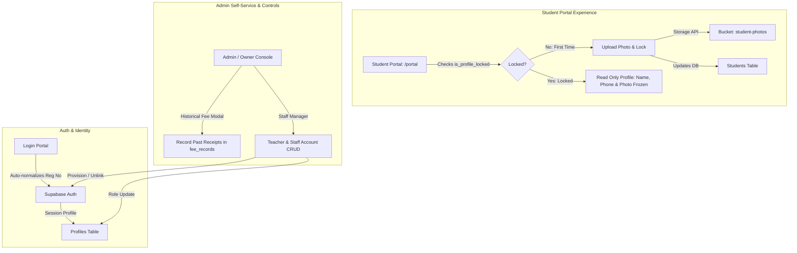

# Student Accounts, Photo-Lock, Historical Fee Records & Staff Auth Plan

> **For agentic workers:** REQUIRED SUB-SKILL: Use superpowers:subagent-driven-development (recommended) or superpowers:executing-plans to implement this plan task-by-task. Steps use checkbox (`- [ ]`) syntax for tracking.

**Goal:** Provide bulk student account generation with recognizable registration usernames and default password `PRADEEPCLASSES`, student portal self-service photo upload with tamper-proof locking (locking photo, name, and phone), admin manual entry of prior historical fee payments, and complete manual staff/teacher account management (add, edit, delete/deactivate).

**Architecture:**
1. **Student Provisioning & Normalized Login:** A Node/TypeScript provisioning script provisions Supabase auth user accounts for all 81 enrolled students with email `${admission_no.toLowerCase()}@student.pradeepclasses.in`, password `PRADEEPCLASSES`, and role `student`, linking each profile to `students.profile_id`. The frontend `Login.tsx` accepts bare registration numbers (e.g. `PC-2025-0001` or `pc-2025-0001`) and transparently resolves them to the student auth domain.
2. **Student Self-Service Photo Upload & Field Locking:** The Student Portal (`Portal.tsx`) provides a profile photo upload widget that uploads directly to the Supabase storage bucket `student-photos`. A dedicated database column/flag `is_profile_locked` (default false) is set to `true` once the student uploads their passport photo. While locked, the photo upload button, name, and mobile number inputs are disabled and non-editable for the student; only institute admins retain unlock/override capabilities.
3. **Prior Historical Fee Payments Engine:** An administrative modal in `Fees.tsx` ("Add Historical Fee Payment") allows admins/accountants to log physical past fee collections (for months prior to November 2026) specifying past collection dates, custom past receipt numbers, paid amounts, payment modes (Cash, UPI, Cheque, Bank Transfer), and settlement remarks with an audited `is_historical: true` flag.
4. **Staff / Teacher Account Lifecycle Management:** The User Management console in `Settings.tsx` and `Teachers.tsx` is expanded to provide full manual controls: create staff accounts with generated or custom temporary passwords, assign/reassign roles (`teacher`, `accountant`, `admin`), reset passwords, deactivate, reactivate, or permanently unlink/remove staff accounts.

**Architecture Diagram:**

**Tech Stack:**
- Frontend: React 18, Vite, TypeScript, Tailwind CSS, Lucide icons
- Backend & Auth: Supabase Auth (Email/Password), PostgreSQL RPCs, Supabase Storage
- Verification: Node / `npx tsx` integration tests and Vite production build

---

## Global Constraints
- Target Institute ID: `11111111-2222-3333-4444-555555555555`.
- Default Student Password: `PRADEEPCLASSES`.
- Normalized Student Username Format: `${admission_no}` (e.g. `PC-2025-0001`) automatically mapped to `${admission_no.toLowerCase()}@student.pradeepclasses.in`.
- Immutability: Once a student uploads their passport photo, `is_profile_locked` becomes true; name, phone, and photo cannot be altered by the student.
- Single-agent execution: All work implemented directly in this session.

---

## Review Focus
1. **Case-insensitive Login:** Students typing `pc-2025-0001`, `PC-2025-0001`, or full email must authenticate without case mismatches.
2. **Photo File Validation:** Files uploaded by students must be image types (JPG, PNG, WebP) under 2MB.
3. **Lock Tamper-Resistance:** Direct API updates attempting to modify name, phone, or photo by a user with `student` role after locking must be rejected by database RLS or API validation.
4. **Historical Receipt Uniqueness:** Historical receipts must respect unique receipt numbering or distinguish historical manual receipts cleanly.
5. **Role Preservation:** Deleting or removing a teacher account must never delete historical student grades, past attendance records, or timetable schedules.

---

## Tasks

### Task 1: Database Migration for Student Profile Lock & Historical Fees
**Files:**
- Create: `supabase/migrations/0019_student_photo_lock_and_historical_fees.sql`
- Modify: `src/types/index.ts`
- Test: `src/tests/studentPhotoLockSchema.test.ts`

**Interfaces:**
- Consumes: `public.students`, `public.fee_records`
- Produces: `students.is_profile_locked boolean default false`, `fee_records.is_historical boolean default false`

- [ ] **Step 1: Write migration `supabase/migrations/0019_student_photo_lock_and_historical_fees.sql`**
Add `is_profile_locked` and `photo_uploaded_at` to `students`; add `is_historical` and `historical_period` to `fee_records`; add RPC `lock_student_profile(p_student_id uuid, p_photo_url text)`.
- [ ] **Step 2: Apply migration to Supabase using `supabase:apply_migration`**
- [ ] **Step 3: Update TypeScript definitions in `src/types/index.ts` and `src/types/finance.ts`**
- [ ] **Step 4: Write test `src/tests/studentPhotoLockSchema.test.ts` to verify RPC and columns**
- [ ] **Step 5: Run test with `npx tsx src/tests/studentPhotoLockSchema.test.ts` and verify PASS**
- [ ] **Step 6: Commit migration and types**

---

### Task 2: Bulk Provisioning of All 81 Student Accounts & Normalized Login
**Files:**
- Create: `scripts/provision_student_accounts.ts`
- Modify: `src/pages/Login.tsx`
- Test: `src/tests/studentAccountAuth.test.ts`

**Interfaces:**
- Consumes: 81 verified students from `students` table
- Produces: 81 active auth user accounts with password `PRADEEPCLASSES`, linked `profile_id`, and registration number login support

- [ ] **Step 1: Write `scripts/provision_student_accounts.ts`**
Iterate over all 81 enrolled students, create auth account with email `${s.admission_no.toLowerCase()}@student.pradeepclasses.in`, password `PRADEEPCLASSES`, role `'student'`, and link `profile_id` on the student record.
- [ ] **Step 2: Run provisioning script to create all 81 accounts in Supabase Auth**
- [ ] **Step 3: Update `src/pages/Login.tsx`**
In `handleSubmit`, normalize input: if input has no `@`, treat as registration number and format as `${input.toLowerCase()}@student.pradeepclasses.in`.
- [ ] **Step 4: Write test `src/tests/studentAccountAuth.test.ts`**
Verify logging in with username `PC-2025-0001` and password `PRADEEPCLASSES` resolves role `student` and links to Aarohi Singh.
- [ ] **Step 5: Run test and verify PASS**
- [ ] **Step 6: Commit student accounts and login normalization**

---

### Task 3: Student Portal Photo Self-Upload & Immutable Locking
**Files:**
- Modify: `src/pages/Portal.tsx`
- Modify: `src/services/studentService.ts`
- Test: `src/tests/studentPhotoUploadLock.test.ts`

**Interfaces:**
- Consumes: `studentService.uploadStudentPhoto(studentId, file)`
- Produces: Instant photo preview, upload to storage, sets `is_profile_locked = true`, disables edit inputs

- [ ] **Step 1: Implement `uploadStudentPhotoAndLock` in `src/services/studentService.ts`**
Upload file to `student-photos` storage bucket and call RPC `lock_student_profile`.
- [ ] **Step 2: Update Profile Card in `src/pages/Portal.tsx`**
Add Passport Photo Upload section. If `is_profile_locked` is false, show upload dropzone and "Confirm & Lock Photo" button with warning: *"Once uploaded, photo, name, and mobile number will be permanently locked."* Once locked, display verified badge and disable modifications.
- [ ] **Step 3: Write test `src/tests/studentPhotoUploadLock.test.ts`**
Verify that a locked profile rejects subsequent modifications and renders as read-only.
- [ ] **Step 4: Run test and verify PASS**
- [ ] **Step 5: Commit Student Portal photo lock feature**

---

### Task 4: Historical Fee Payments Manual Recording in Admin Panel
**Files:**
- Create: `src/components/fees/HistoricalFeeModal.tsx`
- Modify: `src/pages/Fees.tsx`
- Modify: `src/services/feesService.ts`
- Test: `src/tests/historicalFeesManagement.test.ts`

**Interfaces:**
- Consumes: `feesService.recordHistoricalPayment(payload)`
- Produces: Historical fee entry in `fee_records` with status `'paid'`, custom receipt number, and `is_historical: true`

- [ ] **Step 1: Implement `recordHistoricalPayment` in `src/services/feesService.ts`**
Allows specifying `student_id`, `amount`, `payment_method`, `receipt_no`, `payment_date`, `month_period` (e.g. "October 2026", "July 2026"), and `notes`.
- [ ] **Step 2: Create `src/components/fees/HistoricalFeeModal.tsx`**
A clean modal with student search dropdown, past date picker, past month period selector, custom receipt number input, amount, and payment mode.
- [ ] **Step 3: Add "Add Historical Record" button in `src/pages/Fees.tsx`**
Wire modal into the top actions bar of Fee Management.
- [ ] **Step 4: Write integration test `src/tests/historicalFeesManagement.test.ts`**
Test recording a historical fee payment for student `PC-2025-0001` for month "September 2026" and verify it appears in the student's payment history with historical badge.
- [ ] **Step 5: Run test and verify PASS**
- [ ] **Step 6: Commit Historical Fee Management tool**

---

### Task 5: Staff / Teacher Account Provisioning & Manual Management
**Files:**
- Create: `scripts/provision_teacher_accounts.ts`
- Modify: `src/components/settings/UserManagementTab.tsx`
- Modify: `src/pages/Teachers.tsx`
- Modify: `src/services/userService.ts`
- Test: `src/tests/staffAccountManagement.test.ts`

**Interfaces:**
- Consumes: 10 teachers in `teachers` table
- Produces: Teacher auth accounts, manual add staff modal, manual deactivate/reactivate, password reset, and delete/unlink options

- [ ] **Step 1: Write and run `scripts/provision_teacher_accounts.ts`**
Generate auth accounts for all 10 faculty members with canonical emails (e.g. `pradeep.kumar@faculty.pradeepclasses.in`, `avinash.sir@faculty.pradeepclasses.in`), default password `PRADEEPCLASSES`, role `'teacher'`, and link `profile_id` in `teachers` table.
- [ ] **Step 2: Enhance `src/components/settings/UserManagementTab.tsx`**
Add full manual controls: "Add New Staff Member", "Deactivate Account", "Reactivate Account", "Send Password Reset Link", and "Delete/Unlink Account" with confirmation dialogs.
- [ ] **Step 3: Enhance `src/pages/Teachers.tsx`**
Add an action button on each teacher card: "Create / Manage Login Credentials" so admin can directly inspect or create the faculty member's portal access.
- [ ] **Step 4: Write test `src/tests/staffAccountManagement.test.ts`**
Verify creating a new staff account, deactivating it, reactivating it, and verifying permission enforcement.
- [ ] **Step 5: Run test and verify PASS**
- [ ] **Step 6: Commit staff account management features**

---

### Task 6: Full Verification, Production Build & Deployment
- [ ] **Step 1: Run all test suites (`npm run test:operations`, `npm run test:users`, new tests)**
- [ ] **Step 2: Run `npm run build` and ensure 0 TypeScript errors and clean bundle**
- [ ] **Step 3: Push to `origin/main` for automatic production deployment on Vercel**
